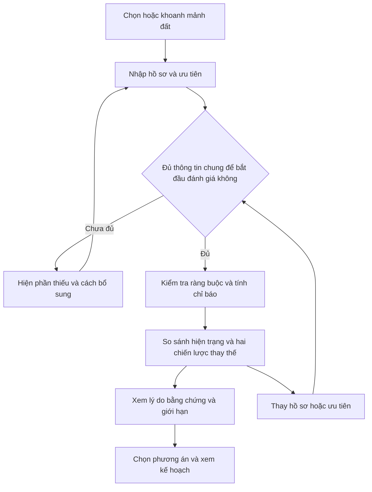
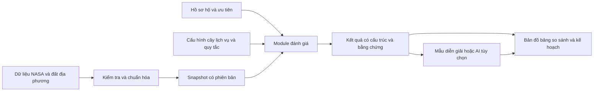

# Hướng dẫn AI xây dựng web nông nghiệp Đồng bằng sông Cửu Long

> Tên làm việc: **Mekong**. Mục tiêu: prototype có dữ liệu thật và một luồng sử dụng hoàn chỉnh cho vòng local NASA Space Apps.
>
> Đọc tài liệu này trước khi lập kế hoạch hoặc viết code. Đây là hướng dẫn triển khai đề xuất, không phải mô tả các chức năng đã được xây dựng. Ngày cập nhật: **14/11/2026**.

**Cách đọc nhanh:** mục 1–4 giải thích sản phẩm và phạm vi; mục 5–6 hướng dẫn giao diện và bản đồ; mục 7–11 hướng dẫn cấu trúc, dữ liệu, AI và trạng thái; mục 13–14 quy định thứ tự làm và nghiệm thu.

## 1. Dự án này giải quyết việc gì

Web giúp nông dân Đồng bằng sông Cửu Long **so sánh các chiến lược luân canh trên mảnh đất đang có**, dựa trên điều kiện môi trường, đất, nguồn nước và ưu tiên của hộ.

Người dùng chọn mảnh đất trên bản đồ, nhập lịch canh tác hiện tại và điều kiện của mình. Hệ thống kết hợp dữ liệu NASA với dữ liệu nông nghiệp địa phương, kiểm tra điều kiện áp dụng rồi so sánh **ba chiến lược gồm hiện trạng và hai phương án thay thế**. Mỗi phương án có lịch cây, lý do, lợi ích có căn cứ, rủi ro và thông tin cần xác nhận.

Câu hỏi trung tâm của sản phẩm:

**Với đất, nguồn nước và khả năng thay đổi của tôi, phương án canh tác nào phù hợp hơn cho những vụ tới, và vì sao?**

Bản đồ là công cụ nhìn điều kiện và rủi ro. Bảng so sánh, bằng chứng và lịch hành động giúp người dùng quyết định. Người nông dân giữ quyền lựa chọn; công cụ hỗ trợ chuyên môn địa phương.

### 1.1. Tài liệu cần đọc trong dự án

| Tài liệu | Dùng để hiểu gì |
| --- | --- |
| [Challenge.md](./Challenge.md) | Mục tiêu luân canh, sức khỏe đất và khả năng thích ứng. Đây là nguồn gốc của định hướng sản phẩm. |
| [Data Information.md](./Data%20Information.md) | Các nguồn dữ liệu được giới thiệu trong đề và vùng phủ cần kiểm tra. |
| [Data.md](./Data.md) | Danh sách đường dẫn dữ liệu để tra cứu. |
| [Cau_truc_va_dinh_huong_du_an_Mekong.docx](./Cau_truc_va_dinh_huong_du_an_Mekong.docx) | Đề xuất chi tiết, mức khó, P0/P1/P2, wow factor và câu hỏi cho team. |
| [Space Apps HCMC 2026 Inperson Handbook](./Space_Apps_HCMC_2026_Inperson_Handbook.md) | Trang 8–11 có hướng trình bày, demo và năm tiêu chí local. |

Nội dung đề dùng nhiều gợi ý tự chọn. Ba chiến lược và phạm vi P0 dưới đây là lựa chọn thiết kế cho bản thi; không tự biến mọi gợi ý trong đề thành điều kiện bắt buộc.

Nếu yêu cầu mới của team thay đổi phạm vi, cập nhật tài liệu và quyết định triển khai cho nhất quán. Không coi các lựa chọn chưa chốt là sự thật đã xác nhận.

## 2. Người dùng và tình huống chính

### 2.1. Người dùng chính

- Hộ canh tác cây ngắn ngày tại vùng thí điểm.
- Người dùng không cần hiểu GIS, chỉ số vệ tinh hoặc kỹ thuật AI.
- Cán bộ khuyến nông hoặc hợp tác xã có thể hỗ trợ nhập hồ sơ và rà soát phương án.

### 2.2. Tình huống dùng để thiết kế

Một hộ đang áp dụng lịch canh tác hiện tại và muốn biết có nên giữ lịch đó hoặc thử một cách luân canh khác. Họ có giới hạn về nước, đất, khả năng đổi cây và nguồn lực. Web cần giúp họ nhìn thấy các đánh đổi và biết dữ liệu nào còn thiếu.

Không tự xác định tỉnh, cây thay thế, giống hoặc lịch vụ cụ thể khi chưa có dữ liệu và nguồn nông học phù hợp. Có thể xây hồ sơ demo giả định để kiểm tra giao diện, nhưng phải gắn nhãn rõ.

### 2.3. Những quyết định còn mở

| Cần chốt | Cách agent xử lý khi chưa có câu trả lời |
| --- | --- |
| Vùng thí điểm và ranh giới | Xây cấu hình vùng và trạng thái ngoài phạm vi; chưa tô toàn ĐBSCL như đã có dữ liệu. |
| Hệ cây và ba lịch luân canh | Xây schema và giao diện; dùng cấu hình minh họa có nhãn nếu cần, chưa gọi là khuyến nghị đã rà soát. |
| Nguồn đất và nguồn nước | Cho phép giá trị chưa biết; xác định điều kiện nào cần dừng đánh giá. |
| Ngưỡng và người kiểm chứng | Lưu nguồn, phiên bản và trạng thái rà soát trong cấu hình; không tự đặt ngưỡng nông học. |
| Tên và nhận diện chính thức | Dùng Mekong làm tên tạm, đặt trong một cấu hình để đổi dễ. |

## 3. Phạm vi thực hiện

### 3.1. P0 là bản thi tối thiểu phải hoàn chỉnh

| Module | Hành vi cần có | Đầu ra |
| --- | --- | --- |
| Bản đồ vùng thí điểm | Chọn điểm hoặc khoanh đất; xem một lớp màu tại một thời điểm. | Vị trí, ranh giới, chú giải và phạm vi dữ liệu. |
| Hồ sơ canh tác | Nhập diện tích, cây và lịch hiện tại, nước, đất, ưu tiên và khả năng đổi cây. | Hồ sơ có đơn vị và trạng thái chưa biết. |
| Dữ liệu môi trường | Tích hợp nguồn mưa/khí tượng NASA phù hợp, cùng thông tin đất và lịch vụ. | Giá trị thật hoặc snapshot thật có nguồn. |
| Kiểm tra điều kiện | Kiểm tra chất lượng dữ liệu và ràng buộc cây, lịch vụ, nước, đất, lựa chọn hộ. | Đủ điều kiện, không đủ điều kiện hoặc chưa đủ căn cứ. |
| So sánh | Hiện trạng và hai chiến lược thay thế; giữ hiện trạng làm mốc. | Chỉ báo đất và nước, điều kiện áp dụng, lý do, thông tin thiếu. |
| Giải thích | Xem nguồn và quy tắc của từng kết luận; có mẫu câu không cần AI. | Kết quả truy được nguồn gốc. |
| Kế hoạch | Xem lịch và hành động có điều kiện cho phương án đã chọn. | Việc cần làm và việc cần xác nhận thêm. |
| Demo ổn định | Dữ liệu phân tích thật lưu sẵn; đổi điều kiện hộ để tính lại có lý do. | Luồng chính chạy được cả khi nguồn bên ngoài lỗi. |

P0 cần một vùng nhỏ và một hệ cây ngắn ngày. Không cần tích hợp tất cả vệ tinh trong đề.

### 3.2. P1 chỉ làm sau khi P0 hoạt động

- Thanh thời gian theo tháng hoặc vụ, đồng bộ bản đồ và lịch.
- Thanh điều chỉnh điều kiện hoặc kịch bản trong phạm vi mô hình đã có.
- Xuất kế hoạch một trang.
- Chuyển đổi thử trên một phần diện tích.
- AI diễn giải bằng tiếng Việt có dẫn nguồn bằng chứng.
- Phát lại một giai đoạn lịch sử nếu đủ dữ liệu đúng thời điểm và nguồn đối chiếu.

### 3.3. P2 và những phần ngoài bản thi đầu

- Mở rộng toàn ĐBSCL và nhiều hệ cây.
- Sầu riêng và quyết định đầu tư cây lâu năm.
- Bản đồ dịch bệnh đã xác nhận.
- Đề xuất thuê đất hoặc chuyển sang vùng khác.
- Tối ưu lịch chung cho hợp tác xã.
- Dự báo năng suất, lợi nhuận, giá bán hoặc carbon đất.
- Hệ thống tài khoản, phân quyền và quản lý trang trại đầy đủ.
- Huấn luyện mô hình AI riêng, hạ tầng nhiều dịch vụ hoặc cảm biến diện rộng.

Không thêm các phần này chỉ để làm demo có nhiều nút hơn.

## 4. Luồng sử dụng



1. Mở web và thấy bản đồ cùng hướng dẫn ngắn: **Chọn mảnh đất để bắt đầu**.
2. Chọn điểm, khoanh đất hoặc chủ động nhấn **Dùng vị trí của tôi**.
3. Xác nhận đây là vị trí mảnh đất. Vị trí điện thoại không mặc nhiên là vị trí canh tác.
4. Nhập hồ sơ theo nhóm ngắn; luôn có lựa chọn **Chưa biết** khi hợp lý.
5. Nhấn **So sánh phương án**.
6. Xem ba chiến lược trên cùng tiêu chí; phương án bị loại vẫn có lý do rõ ràng.
7. Nhấn **Vì sao có kết quả này** để mở bằng chứng.
8. Chọn phương án đủ điều kiện và xem kế hoạch; nếu chưa đủ căn cứ, nhận bước đo hoặc xác nhận bổ sung.
9. Khi thay thông tin ảnh hưởng phân tích, cập nhật kết quả qua một lần tính mới.

Nếu không có chiến lược đủ điều kiện, hiển thị đúng kết quả đó và bước tiếp theo. Không tự chọn một phương án tốt nhất trong nhóm không đạt.

Phân biệt hai mức thiếu thông tin: thiếu đầu vào chung như vị trí hoặc lịch hiện trạng thì cần bổ sung trước khi đánh giá; thiếu dữ liệu thiết yếu riêng của một chiến lược thì vẫn hiển thị cả ba, gắn `insufficient_data` cho chiến lược đó và tiếp tục đánh giá phần còn đủ căn cứ.

## 5. Hướng dẫn giao diện

### 5.1. Định hướng thị giác

Giao diện hiện đại, sáng, gọn và mang tính công cụ sử dụng hằng ngày. Tập trung vào bản đồ, thao tác chọn đất và quyết định canh tác.

- Nền sáng trung tính, chữ đậm vừa đủ, khoảng trắng thoáng.
- Màu xanh ngọc dùng cho hành động và trạng thái đang chọn.
- Bản đồ nền nhẹ để lớp dữ liệu và ranh giới đất nổi bật.
- Card chỉ dùng để nhóm phương án hoặc thông tin cần so sánh; tránh lồng quá nhiều lớp card.
- Mỗi bước có một hành động chính.
- Nội dung quan trọng đọc được trước khi mở chi tiết.
- Không dựng landing page dài trước khi vào bản đồ.
- Không dùng chủ đề vũ trụ, nền sao, địa cầu 3D, neon, kính mờ dày hoặc chuyển động liên tục làm giao diện mặc định.
- Không tự dùng logo NASA như nhận diện sản phẩm hoặc hàm ý được NASA bảo chứng.

### 5.2. Bộ token đề xuất

| Token | Giá trị khởi đầu | Công dụng |
| --- | --- | --- |
| `background` | `#F6F8F7` | Nền ứng dụng. |
| `surface` | `#FFFFFF` | Panel, biểu mẫu, bảng so sánh. |
| `text-primary` | `#172B26` | Nội dung chính. |
| `text-secondary` | `#52635D` | Mô tả, nguồn, thời điểm. |
| `border` | `#DCE5E0` | Viền mảnh và đường phân chia. |
| `primary` | `#0F766E` | Nút chính, liên kết quan trọng, trạng thái đang chọn. |
| `primary-soft` | `#E6F4F1` | Nền nhẹ của vùng chọn. |
| `danger-text / fill` | `#991B1B / #FEE2E2` | Rủi ro cao. |
| `warning-text / fill` | `#92400E / #FEF3C7` | Cần chú ý. |
| `low-risk-text / fill` | `#166534 / #DCFCE7` | Rủi ro thấp hơn trong phạm vi đánh giá. |
| `unknown-text / fill` | `#374151 / #E5E7EB` | Chưa đủ dữ liệu. |

Các màu trên là điểm khởi đầu. Kiểm tra tương phản ở cỡ chữ thực tế; nội dung thông thường đạt tối thiểu 4,5:1, phần tử giao diện quan trọng đạt 3:1. Lớp màu trên bản đồ cần kiểm tra thêm trên nền bản đồ thực tế.

- Font hệ thống hỗ trợ đầy đủ tiếng Việt; không phụ thuộc font từ mạng để demo.
- Chữ nội dung tối thiểu 16 px; mô tả phụ 14 px nếu vẫn đọc rõ; line-height khoảng 1,5.
- Nhịp khoảng cách 4, 8, 12, 16, 24, 32 px.
- Nút và vùng chạm chính tối thiểu 44 × 44 px.
- Bo góc khoảng 10–14 px; bóng đổ nhẹ, dùng tiết chế.
- Chuyển trạng thái ngắn khoảng 150–200 ms; hỗ trợ `prefers-reduced-motion`.
- Màu luôn đi kèm nhãn hoặc biểu tượng; không truyền đạt bằng màu đơn thuần.

### 5.3. Bố cục desktop

```text
┌─────────────────────────────────────────────────────────────────────┐
│ Mekong    Vùng đang xem                 Nguồn dữ liệu    Trợ giúp   │
├───────────────────────┬─────────────────────────────────────────────┤
│ Hồ sơ mảnh đất        │ Bản đồ chính                                │
│                       │                                             │
│ Chọn đất              │ Lớp dữ liệu       Điều khiển bản đồ         │
│ Thông tin canh tác    │                                             │
│ Nước và đất           │         Ranh giới mảnh đất                  │
│ Ưu tiên               │                                             │
│                       │ Chú giải + thời kỳ + nguồn + độ chi tiết    │
│ [So sánh phương án]   │                                             │
├───────────────────────┴─────────────────────────────────────────────┤
│ Khi có kết quả: Hiện trạng  |  Phương án B  |  Phương án C           │
└─────────────────────────────────────────────────────────────────────┘
```

- Top bar khoảng 60–64 px; tên dự án nhỏ gọn.
- Panel trái khoảng 320–380 px; phần bản đồ co giãn theo không gian còn lại.
- Khi có kết quả, mở vùng so sánh đủ rộng hoặc chuyển chế độ làm việc; không nhồi ba card vào panel hẹp.
- Bảng so sánh ba chiến lược nằm ngang khi đủ chiều rộng.
- Bằng chứng mở trong drawer có tiêu đề và nút đóng rõ ràng.
- Không mở đồng thời nhiều panel che khuất gần hết bản đồ.
- Giữ attribution của nền bản đồ và nhà cung cấp dữ liệu nhìn thấy được.

### 5.4. Bố cục mobile

- Dùng cùng một luồng với desktop; không tạo sản phẩm khác trên điện thoại.
- Bản đồ vẫn có vùng xem đủ lớn; hồ sơ mở thành panel dưới hoặc màn hình theo bước.
- Dùng ba bước dễ hiểu: **Mảnh đất → Điều kiện canh tác → So sánh**.
- Card chiến lược xếp dọc, luôn đánh dấu hiện trạng; tránh bảng ngang khó đọc.
- Thanh hành động ở dưới chỉ chứa hành động chính của bước, tôn trọng safe area và không che lỗi nhập liệu.
- Không có cuộn ngang toàn trang ở chiều rộng 360 px.
- Có lựa chọn nhập vị trí thủ công nếu định vị bị từ chối hoặc lỗi.
- Người dùng bàn phím vẫn truy cập được form và kết quả khi không thao tác trực tiếp trên bản đồ.

### 5.5. Nội dung trên từng phần

| Phần | Hiện ngay | Mở khi cần |
| --- | --- | --- |
| Bản đồ | Lớp đang xem, thời kỳ, đơn vị, chú giải, vùng phủ. | Tên sản phẩm, phiên bản, độ phân giải, xử lý đã áp dụng. |
| Hồ sơ | Nhãn trường, đơn vị, giá trị hiện tại, lỗi cạnh trường. | Ví dụ nhập hoặc giải thích thuật ngữ. |
| Chiến lược | Lịch cây, điều kiện áp dụng, điểm cần chú ý, lý do chính. | Chỉ báo chi tiết, nguồn, cách tính. |
| Kế hoạch | Việc cần làm theo giai đoạn và điều cần xác nhận. | Tài liệu tham khảo và giả định áp dụng. |

Không đưa tên API, JSON, raster, model hoặc chi tiết triển khai vào luồng nông dân. Phần **Nguồn và cách đánh giá** có thể hiển thị thuật ngữ chuyên môn kèm giải thích.

### 5.6. Ngôn ngữ giao diện

Ưu tiên tiếng Việt dễ hiểu. Chuẩn bị cấu trúc chuỗi ngôn ngữ để thêm tiếng Anh cho phần demo hoặc hồ sơ dự thi, nhưng chưa cần triển khai hệ thống đa ngôn ngữ phức tạp.

| Nên dùng | Tránh dùng |
| --- | --- |
| So sánh phương án | Chạy AI tối ưu hóa đa mục tiêu |
| Đang kiểm tra điều kiện canh tác | AI đang suy nghĩ |
| Chưa có dữ liệu đất tại vị trí này | Giá trị null |
| Rủi ro thấp hơn theo dữ liệu hiện có | An toàn tuyệt đối |
| Cần xác nhận nguồn nước trước khi chọn | AI bảo đảm đây là phương án tốt nhất |
| Vì sao có kết quả này | Chain of thought |
| Dữ liệu lưu sẵn, cập nhật ngày… | Dữ liệu thời gian thực khi thực tế là cache |

## 6. Quy tắc bản đồ và các lớp dữ liệu

1. P0 chỉ hiển thị **một lớp màu chuyên đề tại một thời điểm** để đọc được chú giải. Có thể giữ ranh giới đất và điểm quan trắc làm lớp nét/điểm riêng.
2. Các lựa chọn ban đầu: **Lượng mưa**, **Nhiệt độ**, **Đất**, **Mức phù hợp theo chiến lược**. Chỉ bật lớp đã có dữ liệu; lớp chưa có cần nhãn rõ hoặc ẩn khỏi luồng chính.
3. Lớp Đất yêu cầu chọn đặc tính cụ thể, như pH hoặc thành phần đất. Không tự tạo điểm chất lượng đất tổng hợp không có định nghĩa.
4. Mưa và nhiệt độ dùng thang màu liên tục theo đơn vị vật lý. Bản đồ đánh giá chiến lược dùng trạng thái rủi ro. Không tô mưa nhiều thành đỏ nguy hiểm khi chưa có đánh giá theo cây và mùa.
5. Mỗi lớp có đơn vị, thời kỳ, nguồn, ngày cập nhật và mức chi tiết dữ liệu.
6. Chuyển lớp chỉ thay cách xem, không thay danh sách dữ liệu đưa vào module đánh giá.
7. Màu được tính từ giá trị thật hoặc dữ liệu minh họa đã gắn nhãn; không tạo vùng màu theo số ngẫu nhiên, khoảng cách tới con trỏ hoặc hình trang trí.
8. Nếu chỉ có một điểm dữ liệu, hiển thị điểm và phạm vi đại diện phù hợp; không tự biến thành heatmap toàn vùng.
9. Dữ liệu cấp vùng không tự thành dữ liệu từng thửa khi zoom. Nội suy để hiển thị phải được ghi nhận và không tăng độ chính xác được công bố.
10. Giữ cùng thang màu khi so sánh các thời kỳ hoặc các chiến lược tương đương. Không tự đổi min/max khiến hai bản đồ trông khác nhau dù giá trị giống nhau.
11. `nodata` phải khác 0; phần không đủ dữ liệu có màu xám hoặc họa tiết và nhãn.
12. GeoJSON dùng tọa độ `[longitude, latitude]` và WGS84. Tính diện tích bằng phép tính địa lý phù hợp, không lấy diện tích theo độ rồi coi là m².
13. Không đánh giá ngoài vùng phủ. Đất nằm một phần ngoài vùng dữ liệu cần thông báo mức phủ và giới hạn kết luận.
14. Bản đồ theo chiến lược chỉ tô vùng có đủ dữ liệu và quy tắc. P0 không buộc phải tính mọi ô trên toàn ĐBSCL.

### 6.1. Màu đánh giá chiến lược

| Trạng thái | Ý nghĩa | Nhãn hiển thị |
| --- | --- | --- |
| Đỏ | Vi phạm điều kiện môi trường hoặc nông học thiết yếu đã kiểm tra, hoặc rủi ro cao theo quy tắc có nguồn. | Rủi ro cao hoặc Không đáp ứng điều kiện, tùy kết luận cụ thể. |
| Vàng | Có điều kiện bất lợi hoặc cần biện pháp bổ sung. | Cần chú ý. |
| Xanh | Rủi ro thấp hơn theo các yếu tố đã được đánh giá. | Rủi ro thấp hơn. |
| Xám | Thiếu căn cứ, dữ liệu không phù hợp hoặc chưa được đánh giá. | Chưa đủ dữ liệu hoặc Chưa đánh giá. |

`eligibility` của một chiến lược và màu rủi ro không phải cùng một biến. Ví dụ hộ không chấp nhận đổi cây khiến phương án không phù hợp với ưu tiên hộ; điều đó không có nghĩa khu vực có rủi ro sinh học cao. Khi chưa đánh giá rủi ro, không tự tô đỏ chỉ vì chiến lược bị loại bởi lựa chọn cá nhân.

## 7. Cấu trúc kỹ thuật

### 7.1. Stack mặc định khi chưa có ứng dụng

- **Web:** Next.js App Router và TypeScript.
- **Giao diện:** Tailwind CSS hoặc bộ CSS token tương đương; component nhỏ và dùng lại được.
- **Bản đồ:** MapLibre GL JS; chỉ khởi tạo một map instance cho vùng làm việc chính.
- **Backend:** Python và FastAPI; Pydantic kiểm tra schema request/response.
- **Lưu trữ P0:** JSON có phiên bản cho cấu hình và snapshot; SQLite nếu cần lưu đánh giá/kế hoạch. Chưa cần PostGIS.
- **AI:** tùy chọn qua backend; mẫu câu xác định sẵn là đường hoạt động mặc định.

Nếu repository đã có ứng dụng và stack đang hoạt động, ưu tiên tái sử dụng; không viết lại chỉ để khớp danh sách trên. Kiểm tra tài liệu chính thức và phiên bản tương thích trước khi cài; lưu lockfile và không ghi phiên bản suy đoán vào code.

Chỉ một dịch vụ chịu trách nhiệm tính toán và xếp hạng. Frontend không sao chép bộ quy tắc sang một bản khác dễ lệch kết quả. Tách hàm tính thuần khỏi API để kiểm chứng được.

### 7.2. Cấu trúc thư mục đề xuất

```text
mekong/
├── web/
│   ├── src/
│   │   ├── app/                     Route và bố cục ứng dụng
│   │   ├── components/ui/           Nút, input, dialog, tabs, badge
│   │   ├── features/
│   │   │   ├── map/                 Map, lớp dữ liệu, chọn đất, chú giải
│   │   │   ├── farm-profile/        Biểu mẫu, đơn vị, kiểm tra hồ sơ
│   │   │   ├── comparison/          Ba chiến lược và đối chiếu
│   │   │   ├── evidence/            Drawer nguồn và quy tắc
│   │   │   └── plan/                Lịch và kế hoạch đã chọn
│   │   ├── lib/                     API client, định dạng số/ngày
│   │   ├── types/                   Kiểu dữ liệu theo hợp đồng API
│   │   └── styles/                  Token và CSS toàn cục
│   └── public/                     Icon và tài nguyên có quyền sử dụng
├── backend/
│   ├── app/
│   │   ├── api/                    Endpoint mỏng, không chứa quy tắc
│   │   ├── schemas/                Đầu vào, đầu ra, trạng thái
│   │   ├── data_pipeline/          Tải, cắt vùng, kiểm tra, tổng hợp
│   │   ├── decision_engine/        Chỉ báo, ràng buộc, xếp hạng
│   │   ├── explanation/            Mẫu câu và AI tùy chọn
│   │   └── repositories/           Đọc snapshot, lưu đánh giá
│   └── tests/                      Ca kiểm chứng quy tắc và API
├── config/
│   ├── pilot_region.json           Phạm vi và mốc thời gian thí điểm
│   ├── crops/                      Đặc tính cây có nguồn
│   ├── rotations/                  Hiện trạng và hai lựa chọn
│   └── rules/                      Ngưỡng, điều kiện, phiên bản rà soát
├── data/
│   ├── raw/                        Dữ liệu gốc và manifest
│   ├── processed/                  Dữ liệu đã chuẩn hóa
│   └── demo_snapshot/              Bộ dữ liệu thật cho demo
├── docs/
│   ├── DATA_SOURCES.md             Nguồn, giấy phép, đơn vị, phạm vi
│   ├── METHODOLOGY.md              Cách tính và giới hạn
│   ├── VALIDATION.md               Những gì đã và chưa kiểm chứng
│   └── DECISIONS.md                Các quyết định team đã chốt
├── .env.example                    Tên biến cấu hình, không có khóa thật
└── README.md                       Cách chạy và trạng thái triển khai
```

Đây là cấu trúc cho ứng dụng tương lai, không phải yêu cầu tạo mọi thư mục rỗng ngay lập tức. Tài liệu đề bài và file đã có ở gốc repository phải được giữ nguyên; không tự di chuyển hoặc xóa.

### 7.3. Thành phần giao diện

```text
AppShell
├── AppHeader
└── MapWorkspace
    ├── FarmProfilePanel
    │   ├── LocationStep
    │   ├── CurrentRotationStep
    │   ├── SoilAndWaterStep
    │   └── PrioritiesStep
    ├── MapCanvas
    │   ├── FarmBoundaryLayer
    │   ├── ThematicLayer
    │   ├── LayerSelector
    │   ├── MapLegend
    │   └── DataCoverageNotice
    ├── ComparisonPanel
    │   └── StrategyCard × 3
    ├── EvidenceDrawer
    └── PlanPanel
```

Ưu tiên một workspace ở `/`. Các bước là trạng thái trong cùng luồng; chưa cần một route cho mọi panel. Route chia sẻ kế hoạch hoặc quản lý tài khoản là phần mở rộng.

### 7.4. Dòng dữ liệu



## 8. Hợp đồng dữ liệu

Định nghĩa schema trung tâm trước khi nối giao diện với dữ liệu. Dùng tên trường nhất quán; kiểu frontend nên sinh hoặc kiểm tra từ schema backend nếu có thể.

### 8.1. Các nhóm đối tượng

| Đối tượng | Trường cần có |
| --- | --- |
| `FarmProfile` | Mã hồ sơ, geometry hoặc điểm đại diện, diện tích và nguồn diện tích, lịch hiện tại, đất, nước, khả năng đổi cây, ưu tiên. |
| `DatasetManifest` | Nguồn, sản phẩm, phiên bản, thời kỳ, ngày phát hành/tải, đơn vị, vùng phủ, độ phân giải, giấy phép, xử lý và chất lượng. |
| `RotationStrategy` | Mã, tên, có phải hiện trạng không, các giai đoạn cây, thời gian, điều kiện áp dụng, nguồn, trạng thái rà soát. |
| `Evaluation` | Mã đánh giá, dấu nhận dạng đầu vào, phiên bản dữ liệu/quy tắc, ba chiến lược, chỉ báo, lý do, phần thiếu, thứ hạng và thời điểm tạo. |
| `Evidence` | Mã, loại dữ liệu hoặc quy tắc, nguồn, vị trí/thời kỳ đại diện, giá trị/đơn vị nếu có, phép xử lý và giới hạn. |
| `Plan` | Chiến lược đã chọn, mã đánh giá gốc, giai đoạn, hành động, điều kiện kích hoạt, việc cần xác nhận và phiên bản. |

### 8.2. Giá trị chưa biết và nguồn gốc

Ví dụ hợp đồng logic dưới đây là hướng dẫn; cần hoàn thiện schema khi triển khai, không sao chép thành dữ liệu giả có vẻ là quan trắc thật.

```ts
type Eligibility = 'eligible' | 'ineligible' | 'insufficient_data';
type RiskLevel = 'high' | 'conditional' | 'lower' | 'unknown';
type DataKind = 'historical' | 'current' | 'forecast' | 'what_if';
type DataOrigin =
  | 'satellite_estimate'
  | 'reanalysis'
  | 'in_situ'
  | 'model_output'
  | 'farmer_reported'
  | 'synthetic';

interface EnvironmentalValue {
  value: number | null;
  unit: string;
  validFrom: string;
  validTo: string;
  publishedAt: string | null;
  retrievedAt: string;
  sourceId: string;
  productVersion: string;
  spatialResolution: { value: number; unit: 'm' | 'km' | 'degree' } | null;
  qualityFlag: 'valid' | 'missing' | 'stale' | 'invalid';
  origin: DataOrigin;
  kind: DataKind;
  processing: 'raw' | 'aggregated' | 'derived';
  deliveryMode: 'live' | 'cached';
  evidenceIds: string[];
}

interface StrategyAssessment {
  strategyId: string;
  isBaseline: boolean;
  eligibility: Eligibility;
  riskLevel: RiskLevel;
  rank: number | null;
  score: number | null; // Chỉ dùng nếu cách tính đã được tài liệu hóa.
  reasons: { code: string; text: string; evidenceIds: string[] }[];
  unmetConstraints: string[];
  missingFields: string[];
  indicators: Record<string, EnvironmentalValue | null>;
}
```

- `null` nghĩa là chưa biết, không phải 0. Không đổi `null` thành 0 để tính điểm hoặc tô màu.
- `qualityFlag` phải xét theo mục đích sử dụng: dữ liệu cũ vẫn có thể hợp lệ cho lịch sử nhưng không đại diện hiện tại. Ghi chính sách độ mới theo từng sản phẩm.
- Bổ sung đơn vị không có thứ nguyên cho pH, tỷ lệ hoặc điểm; không dùng một đơn vị chung cho mọi chỉ báo. `unit` trong ví dụ là trường chuỗi cần chuẩn hóa bằng danh mục.
- Tách ngày quan trắc/thời kỳ đại diện, ngày phát hành và ngày tải.
- Kết quả suy dẫn phải giữ bằng chứng của đầu vào. Bổ sung `methodId`, `methodVersion`, `scenarioId` khi phù hợp.
- Hồ sơ hộ giả định, dữ liệu môi trường thật và thay đổi what-if là ba nguồn thông tin riêng; hiển thị nhãn đúng từng phần.
- `deliveryMode: cached` không có nghĩa dữ liệu giả, cũng không có nghĩa dữ liệu hiện tại.
- Chiến lược `ineligible` hoặc `insufficient_data` có `rank: null` và không được gắn nhãn phương án đề xuất. Không tính điểm mặc định cho phần dữ liệu chưa biết.
- Ngày giờ lưu ở chuẩn ISO rõ múi giờ; giao diện dùng định dạng Việt Nam và giờ UTC+7. Không đổi thời kỳ theo múi giờ trình duyệt một cách âm thầm.

### 8.3. API P0 đề xuất

| API | Mục đích | Lưu ý |
| --- | --- | --- |
| `GET /api/region` | Lấy vùng thí điểm, nguồn sẵn có và thời kỳ được hỗ trợ. | Không báo dữ liệu ngoài vùng là đã hỗ trợ. |
| `GET /api/layers` | Lấy metadata lớp và đường dẫn tài nguyên bản đồ. | Trả đơn vị, chú giải, vùng phủ, ngày cập nhật và nguồn. |
| `POST /api/evaluations` | Gửi hồ sơ, kỳ phân tích, ưu tiên và mã kịch bản nếu có. | Backend kiểm tra input và tính ba chiến lược. |
| `GET /api/evaluations/{id}` | Đọc lại kết quả đã tính. | Chỉ cần nếu P0 có lưu đánh giá; có thể trả trực tiếp ở API tạo. |
| `GET /api/evidence/{id}` | Xem dữ liệu hoặc quy tắc tạo kết luận. | Không lộ khóa, thông tin riêng hoặc tài liệu không được phép chia sẻ. |

Sai định dạng trả lỗi nhập liệu. Dữ liệu nông học chưa đủ là một trạng thái hợp lệ của đánh giá, không phải lỗi máy chủ. Lỗi nguồn bên ngoài cần thông điệp riêng và snapshot dự phòng nếu có.

## 9. Dữ liệu và bộ quy tắc

### 9.1. Nguồn ưu tiên

| Nhóm | Vai trò | Quy tắc tích hợp |
| --- | --- | --- |
| NASA GPM IMERG | Mưa tích lũy, phân bố và bất thường theo kỳ. | Chọn sản phẩm và độ trễ phù hợp; phân biệt mm với mm/giờ. |
| NASA POWER | Nhiệt độ và điều kiện khí tượng vùng. | Lưu định nghĩa biến và tính đại diện; lịch sử không tự thành dự báo. |
| SoilGrids hoặc mẫu đất | Đặc tính đất nền hoặc thông tin đo tại chỗ. | Lưu tầng sâu và độ bất định nếu có. Ưu tiên cutout/snapshot, kiểm tra lại trạng thái dịch vụ trước triển khai. |
| Tài liệu địa phương | Lịch vụ, yêu cầu cây và điều kiện luân canh. | Có nguồn và trạng thái rà soát; không để mô hình ngôn ngữ tự đặt. |
| Quan trắc nước hoặc bản tin phù hợp | Nước và mặn khi tiếp cận được. | Kiểm tra vị trí, thời gian và đối tượng đo; không suy ra từ mưa. |
| Landsat hoặc Sentinel 2 | P1 cho thảm thực vật và thời kỳ đất trống. | Xử lý mây, độ phân giải và nguồn gốc; không dùng NDVI để xác nhận bệnh. |

Tài liệu Word ghi nhận SoilGrids thông báo tạm dừng REST API tại lần kiểm tra 14/11/2026. Đây là tình trạng theo thời điểm, không phải thuộc tính vĩnh viễn. Agent phải kiểm tra lại khi tích hợp và luôn có phương án đọc lớp tải sẵn.

Snapshot dữ liệu phân tích không tự làm nền bản đồ hoạt động ngoại tuyến. Khi tile nền không tải được, vẫn hiển thị ranh giới vùng, geometry mảnh đất và kết quả bằng dữ liệu lưu sẵn, kèm thông báo nền bản đồ chưa tải. Nếu cần lưu tile hoặc ảnh nền, chỉ dùng nguồn cho phép lưu theo điều khoản của nhà cung cấp; giữ attribution. Không gọi chế độ này là cập nhật thời gian thực.

Với P0, chế độ demo khi mất Internet có thể chạy bằng web/backend cục bộ đã khởi động, dữ liệu, overlay và metadata cục bộ. Nêu rõ các thành phần phải có sẵn trong README. Chưa bắt buộc xây PWA hoặc service worker, và không hứa ứng dụng đã deploy sẽ tải mới được khi hoàn toàn không có mạng.

Không gán bộ dữ liệu chỉ phủ Hoa Kỳ như SSURGO, CDL hoặc PRISM cho ĐBSCL. Kiểm tra vùng phủ và quyền sử dụng trước khi tải, cache hoặc đưa vào demo.

### 9.2. Thứ tự xử lý bắt buộc

```text
Kiểm tra hồ sơ và chất lượng dữ liệu
→ lấy giá trị phù hợp vùng và thời kỳ
→ tổng hợp theo cùng kỳ phân tích
→ kiểm tra điều kiện thiết yếu cho từng chiến lược
→ tính chỉ báo có định nghĩa và nguồn
→ xếp hạng các phương án đủ điều kiện theo ưu tiên
→ tạo lý do và danh sách thông tin còn thiếu
→ tạo kế hoạch có điều kiện
→ diễn giải bằng mẫu câu hoặc AI
```

- Ngưỡng loại trừ chạy trước trọng số. Yếu tố tốt không được bù một vi phạm thiết yếu.
- Nếu hộ không đồng ý đổi cây, giữ hiện trạng và đánh dấu các phương án thay cây không đáp ứng lựa chọn của hộ; không âm thầm bỏ qua giới hạn này.
- Hiện trạng vẫn được đánh giá bằng cùng quy tắc; không mặc nhiên đủ điều kiện chỉ vì đã được áp dụng trước đó.
- Nếu các chiến lược gần nhau, thể hiện đánh đổi hoặc đồng hạng. Không buộc phải có một phương án thắng.
- Điểm phù hợp tự xây không phải xác suất thành công. Không hiện phần trăm độ chính xác AI khi chưa có kiểm định và hiệu chuẩn.
- Mặn đất, mặn nước tưới và nước trữ cần biến, đơn vị và nguồn riêng. Cùng giá trị số nhưng khác phương pháp đo không mặc nhiên so sánh được.
- Thời gian che phủ, đa dạng cây hoặc vai trò cây họ đậu là chỉ báo hỗ trợ sức khỏe đất khi có cơ sở. Không biến thành khẳng định carbon hoặc độ phì tăng bao nhiêu.
- Kết quả hiện tại, lịch sử, dự báo và what-if phải được phân biệt cả trong schema và giao diện.
- Nếu thiếu mô hình dự báo được kiểm chứng, dùng phân tích lịch sử và kịch bản có nhãn; không tự dự báo thời tiết chi tiết từng vườn nhiều tháng trước.

## 10. Vai trò của AI

AI là phần giải thích tùy chọn. Kết quả cốt lõi phải chạy được khi chưa có API key hoặc nhà cung cấp AI lỗi.

### AI được làm

- Diễn giải kết quả có cấu trúc bằng ngôn ngữ dễ hiểu.
- Tóm tắt khác biệt giữa ba chiến lược từ các chỉ báo đã tính.
- Sắp xếp hành động đã có thành lịch dễ đọc.
- Giải thích thuật ngữ từ tài liệu được phép dùng.

### AI không được tự làm

- Tạo số đo môi trường, ngưỡng cây, lịch luân canh hoặc kết quả kiểm chứng.
- Thay đổi thứ hạng hoặc điều kiện loại trừ do module đánh giá tạo ra.
- Khẳng định nơi đang nhiễm bệnh khi chỉ có chỉ báo môi trường.
- Hứa tăng lợi nhuận, tiết kiệm nước hoặc bảo đảm năng suất không có phép tính và dữ liệu.
- Đưa lời khuyên thuốc hoặc liều lượng như một chức năng ngoài phạm vi bản thi.
- Công bố suy luận nội bộ. Phần giải thích dùng nguồn, quy tắc và các yếu tố dẫn tới kết quả.

Backend chỉ gửi dữ liệu tối thiểu cần thiết cho AI. Kiểm tra đầu ra có đủ nguồn bằng chứng và không thêm con số ngoài kết quả gốc; dùng mẫu diễn giải dự phòng khi không đạt. Không để API key trong bundle frontend hoặc log. Không gửi danh tính, tọa độ riêng của hộ tới AI khi chưa có lý do và quyền phù hợp.

## 11. Trạng thái giao diện và tính lại kết quả

| Trạng thái | Giao diện phải làm gì | Hành động tiếp theo |
| --- | --- | --- |
| Chưa chọn đất | Hướng dẫn ngắn, không hiện kết quả giả. | Chọn trên bản đồ hoặc nhập vị trí. |
| Đang nhập | Giữ dữ liệu đã điền và kiểm tra cạnh trường. | Hoàn thành thông tin thiết yếu. |
| Ngoài vùng thí điểm | Nêu phạm vi hỗ trợ, không chạy như đã có dữ liệu. | Chọn vùng hỗ trợ. |
| Đang tải | Skeleton hoặc tiến trình thực; tránh chặn cả ứng dụng. | Có thể sửa đầu vào hoặc hủy nếu hợp lý. |
| Dữ liệu thiếu | Chỉ rõ trường, nguồn hoặc thời kỳ còn thiếu. | Bổ sung hoặc xem phân tích hạn chế có nhãn. |
| Nguồn lỗi hoặc dữ liệu cũ | Nêu nguồn lỗi, ngày snapshot đang dùng và giới hạn. | Thử lại hoặc dùng snapshot phù hợp. |
| Không có phương án đạt | Giữ ba phương án và lý do; không gắn nhãn đề xuất tốt nhất. | Rà soát giới hạn hoặc đo thêm. |
| Có kết quả | Hiện ba chiến lược, bằng chứng và thời điểm tính. | Chọn phương án hoặc sửa hồ sơ. |
| Đầu vào đã thay đổi | Kết quả cũ có nhãn chưa cập nhật. | Tính lại trước khi chốt kế hoạch. |
| AI lỗi | Kết quả và mẫu câu vẫn dùng được. | Tiếp tục xem hoặc thử diễn giải lại. |

Quy tắc đồng bộ:

- Lớp bản đồ, vùng đất, kỳ phân tích, chiến lược đang chọn và đánh giá đang dùng có nguồn trạng thái rõ ràng.
- Thay geometry, lịch cây, nguồn nước hoặc ưu tiên làm kết quả cũ hết hiệu lực đối với hồ sơ mới.
- Tắt/mở lớp xem, đóng drawer hoặc đổi zoom không tự làm thay đổi đánh giá.
- Mỗi request đánh giá có dấu nhận dạng đầu vào hoặc sequence ID. Response cũ trả về muộn không được ghi đè response mới.
- Hủy request cũ khi phù hợp; cache có khóa bao gồm hồ sơ, kỳ phân tích, phiên bản dữ liệu và quy tắc.
- Kế hoạch luôn gắn với `evaluationId`; không ghép kế hoạch của hồ sơ cũ vào bản đồ mới.
- Giữ kết quả không đổi khi mô hình không cho thấy khác biệt. Không ép màu hoặc thứ hạng thay đổi chỉ để tạo hiệu ứng demo.

## 12. Wow factor ưu tiên

### Cùng mảnh đất nhưng khác khả năng thích ứng

Demo giữ nguyên mảnh đất và dữ liệu môi trường, thay đổi khả năng nước của hộ. Hệ thống tính lại điều kiện và phương án, rồi chỉ rõ yếu tố nào làm kết quả khác đi.

Giá trị cần người xem nhận ra: dữ liệu cấp vùng được kết hợp với hoàn cảnh hộ để hỗ trợ một quyết định cụ thể.

Yêu cầu:

1. Biến thay đổi có liên hệ được mô hình hóa và có nguồn nông học.
2. Đầu vào thay đổi thực sự đi qua module đánh giá, không chỉ đổi chữ trên card.
3. Hiển thị kết quả trước/sau và lý do bằng ngôn ngữ dễ hiểu.
4. Không bịa phần trăm tiết kiệm hoặc hiệu quả canh tác.
5. Nếu thứ hạng giữ nguyên, giải thích yếu tố chi phối; không sửa kết quả để gây ấn tượng.

Phần hỗ trợ nếu còn thời gian: bản đồ và lịch đổi đồng bộ khi chọn chiến lược. Giữ nhãn rõ phần lịch sử, phần dữ liệu hiện có và phần giả định.

## 13. Thứ tự agent nên thực hiện

1. **Đọc và kiểm tra repository.** Xác định tài liệu, code đã có, lệnh chạy và ràng buộc. Không ghi đè tài liệu nguồn.
2. **Chốt phạm vi kỹ thuật tối thiểu.** Ghi các quyết định và điều còn thiếu; tái sử dụng stack hiện hữu nếu có.
3. **Thiết kế schema và trạng thái.** Dữ liệu chưa biết, nguồn bằng chứng, ba chiến lược và kết quả chưa đủ căn cứ cần có ngay từ đầu.
4. **Dựng luồng giao diện.** Bản đồ, chọn đất, hồ sơ, so sánh và kế hoạch theo cùng mô hình trạng thái. Dữ liệu mock chỉ dùng có nhãn.
5. **Tích hợp một lát dữ liệu thật.** Vùng nhỏ, thời kỳ rõ, metadata đủ; tạo snapshot có thể kiểm tra lại.
6. **Xây bộ quy tắc có nguồn.** Ràng buộc trước xếp hạng; đầu ra có lý do và trường thiếu. Nếu chưa có cấu hình nông học hợp lệ, giữ trạng thái minh họa hoặc chưa đủ căn cứ.
7. **Nối giao diện với xử lý thật.** Bỏ đường hardcode kết quả demo khỏi luồng phân tích thực; xử lý tính lại và response cũ.
8. **Kiểm chứng các ca quan trọng.** Dữ liệu thiếu, loại trừ, đơn vị, cùng đầu vào cùng kết quả, mất mạng và luồng mobile.
9. **Thêm điểm nhấn.** Thay nguồn lực và giải thích khác biệt; chỉ thêm AI sau khi core chạy ổn.
10. **Cập nhật tài liệu bàn giao.** Cách chạy, nguồn, biến môi trường, phần đã làm, dữ liệu đã tích hợp và giới hạn còn lại.

Khi thiếu dữ liệu hoặc quyết định chưa chốt, tiếp tục những phần độc lập như giao diện, schema và kiểm tra trạng thái. Chỉ hỏi team các thông tin thật sự chặn việc lựa chọn vùng/cây/ngưỡng. Không tự lấp chỗ trống bằng dữ liệu giả không nhãn.

## 14. Tiêu chí nghiệm thu

### 14.1. Sản phẩm

- [ ] Người mới hiểu mục tiêu web và bước bắt đầu mà không cần thuyết trình kèm.
- [ ] Chọn hoặc khoanh đất, nhập hồ sơ, xem ba chiến lược trong một luồng hoàn chỉnh.
- [ ] Hiện trạng luôn có nhãn và dùng cùng tiêu chí đánh giá.
- [ ] Không đồng ý đổi cây được tôn trọng.
- [ ] Không có phương án đạt hoặc chưa đủ dữ liệu được xử lý rõ.
- [ ] Chọn phương án đủ điều kiện mới tạo được kế hoạch áp dụng; bản xem thử khác có nhãn minh họa.

### 14.2. Dữ liệu và khoa học

- [ ] Có ít nhất một nguồn NASA thật tham gia tạo chỉ báo và kết quả, không chỉ nằm trong phần giới thiệu.
- [ ] Truy được một giá trị từ sản phẩm gốc qua phép xử lý đến nhận định trên giao diện.
- [ ] Dữ liệu thiếu, chất lượng kém và dữ liệu cũ không bị thay bằng 0 hoặc màu xanh.
- [ ] Ràng buộc quan trọng không bị các điểm thuận lợi bù mất.
- [ ] Độ phân giải và vùng phủ được công khai; không tạo độ chính xác theo thửa từ dữ liệu thô.
- [ ] Mặn, bệnh và dự báo chỉ được kết luận trong phạm vi có bằng chứng.
- [ ] Phân biệt phần mềm chạy đúng, nhận định môi trường đã đối chiếu và khuyến nghị đã được chuyên môn nhận xét.

### 14.3. Giao diện và kỹ thuật

- [ ] Hoạt động ở chiều rộng 360 px và desktop; không có cuộn ngang ngoài vùng bảng được chủ ý.
- [ ] Điều khiển dùng được bằng bàn phím; có focus, label và lỗi đọc được.
- [ ] Màu có nhãn; chú giải và nguồn không bị panel hoặc attribution khác che.
- [ ] Thay input làm đánh dấu kết quả cũ; response muộn không ghi đè kết quả mới.
- [ ] Cùng đầu vào, dữ liệu và quy tắc tạo cùng kết quả.
- [ ] Khi AI hoặc nguồn ngoài lỗi, dữ liệu snapshot và mẫu câu vẫn hoạt động đúng nhãn.
- [ ] Không có API key, dữ liệu hộ riêng tư hoặc dependency không cần thiết trong bản công khai.
- [ ] Nút nào xuất hiện cũng hoạt động, có trạng thái vô hiệu hóa hợp lý hoặc được ghi rõ chưa hỗ trợ.

### 14.4. Demo và bàn giao

- [ ] Có một ca demo khoảng 60–90 giây cho luồng chính; thời lượng pitch thực tế theo ban tổ chức.
- [ ] Hồ sơ giả định, dữ liệu thật lưu sẵn và kịch bản what-if được gắn nhãn riêng.
- [ ] Có bằng chứng kiểm tra cụ thể thay cho một chỉ số độ chính xác AI chung chung.
- [ ] README hướng dẫn chạy và nêu trạng thái tích hợp thực tế.
- [ ] Báo cáo cuối ghi rõ phần đã xây, cách kiểm tra, phần còn thiếu và quyết định cần team chốt.

## 15. Liên hệ với tiêu chí local

| Tiêu chí | Điều agent cần giúp team thể hiện |
| --- | --- |
| Impact | Một nhóm người dùng, một quyết định cụ thể, cách đo lợi ích sau thử nghiệm. |
| Creativity | Hoàn cảnh hộ làm phương án thay đổi có căn cứ và khác biệt có thể trình diễn. |
| Validity | Quy tắc minh bạch, dữ liệu thật, kiểm chứng, giao diện dễ dùng và giới hạn rõ. |
| Relevance | Luân canh, chỉ báo sức khỏe đất, ưu tiên nông dân và vai trò thật của dữ liệu NASA. |
| Presentation | Một luồng ngắn, bản đồ dễ đọc, ba phương án và lý do có thể kiểm tra. |

Không đặt mục tiêu phải có mọi tính năng. Ưu tiên một ca hoàn chỉnh mà team giải thích và bảo vệ được trước câu hỏi về dữ liệu, phương pháp và tính thực tế.

## 16. Tài liệu kỹ thuật và nguồn chính thức

Tra tài liệu hiện hành khi triển khai thay vì giả định phiên bản, endpoint hoặc quyền truy cập còn giống trước.

- [Next.js App Router](https://nextjs.org/docs/app/getting-started): tổ chức ứng dụng và route.
- [MapLibre GL JS](https://maplibre.org/maplibre-gl-js/docs/): nguồn và lớp bản đồ.
- [MapLibre examples](https://maplibre.org/maplibre-gl-js/docs/examples/): GeoJSON, raster và điều khiển bản đồ.
- [FastAPI response models](https://fastapi.tiangolo.com/tutorial/response-model/): kiểm tra hợp đồng đầu ra.
- [NASA GPM IMERG](https://gpm.nasa.gov/data/imerg): dữ liệu mưa và sản phẩm xử lý.
- [NASA POWER](https://power.larc.nasa.gov/): dữ liệu khí tượng.
- [ISRIC SoilGrids](https://isric.org/explore/soilgrids/): thuộc tính đất, độ bất định và trạng thái dịch vụ.
- [Viện Khoa học Thủy lợi miền Nam](https://siwrr.org.vn/): nguồn tham khảo nước và xâm nhập mặn.
- [Copernicus về dự báo mùa](https://climate.copernicus.eu/how-read-c3s-seasonal-forecasts): cách diễn giải tương lai và độ bất định.

**Chỉ dẫn bắt đầu cho agent:** đọc tài liệu nguồn và code hiện có, lập một kế hoạch ngắn theo P0, xác định cấu hình còn thiếu rồi triển khai từng phần có thể kiểm chứng. Giữ giao diện tập trung vào quyết định canh tác và giữ mọi kết luận truy được về dữ liệu hoặc quy tắc.
