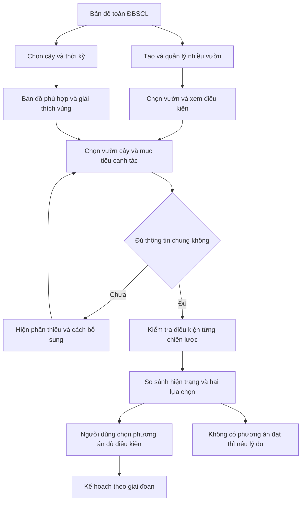
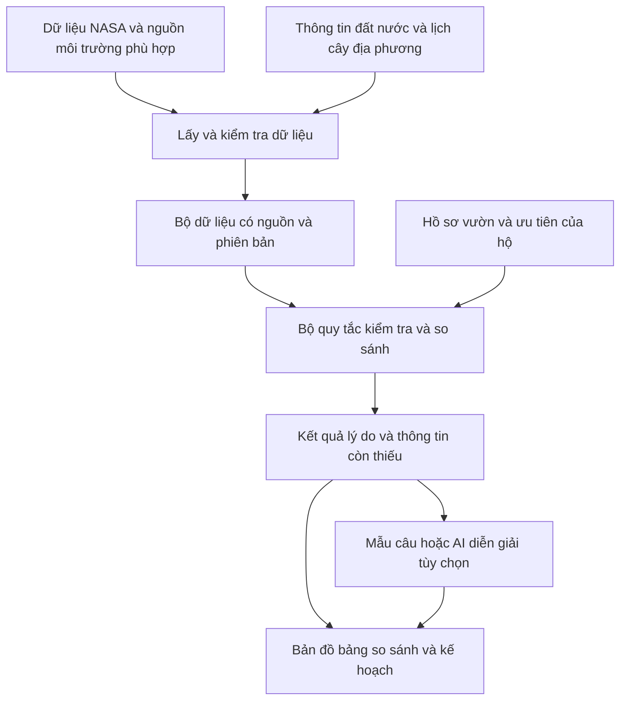

# Tổng quan web nông nghiệp Đồng bằng sông Cửu Long

**Tên làm việc: Mekong | Cập nhật ngày 14/11/2026 | Dành cho toàn bộ thành viên team**

## 1. Dự án về cái gì

Mekong là web lấy bản đồ toàn Đồng bằng sông Cửu Long làm trung tâm. Người dùng tạo và quản lý nhiều khu vườn, xem điều kiện môi trường, tìm nơi phù hợp với cây đang quan tâm và khám phá chiến lược canh tác cho vườn của mình.

Mục tiêu sản phẩm là giúp người nông dân hiểu **đất của mình đang có điều kiện gì, cây nào có thể phù hợp và nên cân nhắc cách canh tác nào**. Kết quả cần có lý do và nguồn dữ liệu để người dùng xem xét cùng chuyên môn địa phương.

Mục tiêu cuộc thi là có một bản thử nghiệm thuyết phục ở vòng local NASA Space Apps. Trọng tâm đề bài là **luân canh, sức khỏe đất và thích ứng với thời tiết, nguồn nước**. Vì vậy, phần chiến thuật cần tiến tới so sánh lịch cây qua các vụ, không dừng ở hướng dẫn chăm sóc chung. [1]

### Ba tính năng chính đã được xác định

| Tính năng | Câu hỏi người dùng muốn trả lời | Kết quả chính |
| --- | --- | --- |
| 1. Vườn của tôi | Vườn ở đâu, hình dạng thế nào và nằm trong điều kiện gì? | Nhiều vườn có ranh giới, mô tả và các lớp môi trường liên quan. |
| 2. Cây này phù hợp ở đâu | Nếu chọn cây này, những vùng nào phù hợp hơn và có rủi ro gì? | Bản đồ mức phù hợp và giải thích khi bấm vào vùng. |
| 3. Chiến thuật cho vườn | Với vườn và nguồn lực của tôi, nên cân nhắc cách canh tác nào? | Các phương án có điều kiện áp dụng, đánh đổi và kế hoạch theo giai đoạn. |

### Cách hiểu trạng thái nội dung

**Hướng đã xác định:** bản đồ toàn ĐBSCL, nhiều khu vườn và ba tính năng trên. **Đề xuất triển khai:** chọn thêm mùa vụ, so sánh hiện trạng với hai chiến lược thay thế, nguồn dữ liệu ưu tiên và các wow factor. **Còn cần chốt:** tên chính thức, cây đầu tiên, vùng kiểm chứng, ngưỡng nông học và người phụ trách.

Các phần dưới đây mô tả sản phẩm cần xây và các đề xuất cho team lựa chọn; không xác nhận rằng tính năng hoặc hiệu quả thực địa đã được triển khai.

<!-- PAGE -->

## 2. Tính năng một tạo và quản lý vườn

Người dùng bật vị trí để bản đồ di chuyển tới khu vực đang đứng, sau đó vẽ đường bao vườn, thêm mô tả và lưu lại. Có thể tạo thêm nhiều vườn rồi chọn vườn muốn xem hoặc đánh giá.

### Luồng sử dụng

1. Bật vị trí hoặc tìm khu vực bằng tay nếu không dùng định vị.
2. Nhấn **Thêm khu vườn**, vẽ đường bao và kiểm tra lại vị trí.
3. Xem diện tích được tính từ hình vẽ; sửa ranh giới nếu chưa đúng.
4. Nhập tên, lịch canh tác hiện tại, mô tả đất và nguồn nước.
5. Lưu vườn, chuyển giữa các vườn hoặc tiếp tục thêm vườn khác.
6. Bật lớp dữ liệu để xem điều kiện tại vườn đang chọn.

| Nhóm thông tin vườn | Nội dung nên có |
| --- | --- |
| Nhận diện và vị trí | Tên vườn, đường bao, diện tích và ghi chú. Vị trí điện thoại cần được xác nhận lại là vị trí vườn. |
| Canh tác hiện tại | Cây đang trồng, lịch các vụ, giai đoạn sinh trưởng khi có thông tin. |
| Đất và nước | Kết quả đất đã biết; nguồn tưới; khả năng trữ, tưới bổ sung và thoát nước. |
| Lựa chọn của hộ | Có cho phép đổi/thêm cây giữa các vụ không; ưu tiên tiết kiệm nước, đất hoặc khả năng đầu tư. |
| Phần chưa biết | Có lựa chọn chưa biết. Giá trị thiếu được giữ nguyên trạng thái để hệ thống xử lý. |

### Người dùng nhận lại gì

Ngoài màu trên bản đồ, vườn cần có tóm tắt dễ đọc như “lượng mưa thấp trong thời kỳ đang xem”, kèm ngày và nguồn. Nếu dữ liệu đại diện vùng rộng, thông tin này phải được ghi rõ; không gọi đó là số đo riêng trong vườn.

Tắt hoặc bật một lớp chỉ thay cách xem. Phần phân tích vẫn sử dụng các dữ liệu liên quan có căn cứ, kể cả lớp đang tắt.

### Điều cần thống nhất

Hỗ trợ nhiều vườn theo khả năng hệ thống; chưa hứa lưu không giới hạn. Bản đầu ưu tiên tạo, chọn và sửa thông tin vườn. Cơ chế tài khoản, đồng bộ nhiều thiết bị và chia sẻ vườn cần chốt riêng khi thật sự cần.

<!-- PAGE -->

## 3. Tính năng hai bản đồ phù hợp với cây

Người dùng chọn cây trong danh sách. **Đề xuất thêm lựa chọn mùa vụ/thời kỳ** để kết quả có ý nghĩa, vì cùng một cây và một vị trí có thể gặp điều kiện khác nhau theo thời gian.

### Luồng sử dụng

1. Chọn cây và thời kỳ cần xem.
2. Bản đồ thể hiện mức phù hợp tại những nơi có đủ dữ liệu và quy tắc.
3. Bấm vào một vùng để đọc lý do, rủi ro và điều kiện áp dụng.
4. Chọn **Áp dụng cho vườn của tôi** để chuyển sang đánh giá vườn đã lưu.

| Màu | Cách diễn giải | Thông tin cần đi kèm |
| --- | --- | --- |
| Xanh | Phù hợp hơn hoặc rủi ro thấp hơn theo các yếu tố đã xét. | Những điều kiện thuận lợi và phạm vi đánh giá. Không bảo đảm năng suất. |
| Vàng | Có điều kiện bất lợi hoặc cần biện pháp bổ sung. | Yếu tố cần chú ý và điều cần kiểm tra trước khi áp dụng. |
| Đỏ | Không đáp ứng điều kiện môi trường/nông học quan trọng hoặc rủi ro cao. | Điều kiện nào dẫn tới kết luận, theo cây và thời kỳ nào. |
| Xám | Chưa đủ dữ liệu hoặc chưa được đánh giá. | Thông tin còn thiếu và khả năng bổ sung. |

### Khi bấm vào vùng

| Nội dung | Người dùng cần hiểu |
| --- | --- |
| Vì sao có màu này | Điều kiện nào tạo ra kết quả; tránh một điểm số không có giải thích. |
| Rủi ro chính | Nóng, nước hoặc điều kiện đất nào cần chú ý trong phạm vi đã xét. |
| Hướng canh tác tham khảo | Những điều kiện và biện pháp có nguồn phù hợp với vùng; chưa phải kế hoạch riêng cho mọi hộ. |
| Nguồn và giới hạn | Thời kỳ, nguồn dữ liệu, mức chi tiết và điều chưa biết. |

Màu đánh giá cây khác với màu của lớp mưa hoặc nhiệt độ. Mưa nhiều không tự có nghĩa nguy hiểm; cần xét cây, mùa và điều kiện canh tác. Lựa chọn “không muốn đổi cây” của hộ cũng không phải lý do tô vùng đất thành đỏ.

Bản đồ toàn vùng là phạm vi trải nghiệm. Chỗ chưa có căn cứ vẫn được xem các lớp đã có, nhưng phần đánh giá phải giữ trạng thái chưa đủ dữ liệu.

<!-- PAGE -->

## 4. Tính năng ba chiến thuật cho vườn hiện tại

Người dùng chọn vườn đã lưu, cây muốn trồng và mục tiêu của mình. Hệ thống kết hợp dữ liệu môi trường, thông tin vườn và quy tắc nông học để hỗ trợ lựa chọn chiến lược.

**Đề xuất triển khai để sát đề:** so sánh lịch hiện trạng với hai chiến lược luân canh thay thế có căn cứ. Đề bài gợi ý so sánh ít nhất ba chiến lược; đây là lựa chọn thiết kế của team, không biến mọi gợi ý trong đề thành yêu cầu bắt buộc. [1]

| Nội dung so sánh | Cần thể hiện |
| --- | --- |
| Lịch cây qua các vụ | Cây gì vào giai đoạn nào, thời gian chiếm đất và khoảng nghỉ theo lịch. |
| Điều kiện đất và nước | Yêu cầu của phương án có đáp ứng thông tin hiện có của vườn không. |
| Sức khỏe đất | Chỉ báo có căn cứ như đa dạng cây, thời gian có cây/che phủ theo kế hoạch hoặc vai trò cây họ đậu. |
| Khả năng áp dụng | Nguồn lực, thiết bị, mức sẵn sàng đổi cây và thông tin còn thiếu. |
| Lý do và đánh đổi | Vì sao phương án được xét, điểm thuận lợi và bất lợi so với hiện trạng. |
| Kế hoạch | Việc cần làm theo giai đoạn, điều kiện áp dụng và việc cần xác nhận thêm. |

### Nhánh giữ cây hoặc cho phép đổi cây

**Nếu giữ cây:** ưu tiên những điều chỉnh lịch và cách quản lý nằm trong giới hạn hộ cho phép. Các phương án thay cây vẫn có thể xuất hiện để tham chiếu nhưng phải được đánh dấu không đáp ứng lựa chọn của hộ.

**Nếu cho phép đổi/thêm cây giữa các vụ:** đánh giá thêm các chiến lược luân canh phù hợp. Cây và lịch thay thế cần được lựa chọn từ nguồn có căn cứ, không để AI tự tạo như đã được chuyên môn xác nhận.

### Cách xử lý kết quả

Mỗi phương án có trạng thái riêng: đủ điều kiện, không đáp ứng điều kiện hoặc chưa đủ căn cứ. Thiếu dữ liệu cho một phương án không nhất thiết chặn các phương án còn lại. Hiện trạng cũng phải được đánh giá, không mặc nhiên được coi là phù hợp.

Nếu không có phương án đạt, hệ thống nêu lý do và việc cần đo/xác nhận. Khi người dùng thay thông tin, kết quả cũ được đánh dấu chưa cập nhật và cần tính lại trước khi chọn kế hoạch.

<!-- PAGE -->

## 5. Sơ đồ hoạt động của web

Hai đường vào cùng dẫn tới phần đánh giá vườn: bắt đầu từ một vườn đã tạo hoặc bắt đầu từ cây đang quan tâm trên bản đồ toàn vùng.

Nếu chưa có phương án đủ điều kiện, hệ thống nêu lý do và việc cần bổ sung. Khi sửa hồ sơ, người dùng cần tính lại trước khi chọn kế hoạch.

<!-- PAGE -->

## 6. Dữ liệu và lớp bản đồ

Đề xuất bắt đầu POWER cho điều kiện khí tượng và IMERG cho mưa; bổ sung đất, nước và lịch cây địa phương. Chỉ thêm nguồn khác khi có vai trò rõ. Danh sách BTC gồm nhiều cơ quan; không gọi tất cả là dữ liệu NASA. [2, 3]

| Lớp hoặc nhóm yếu tố | Cách dùng đề xuất | Điều cần nhớ |
| --- | --- | --- |
| Nhiệt độ và nóng bất lợi | Dữ liệu khí tượng kết hợp cây và giai đoạn. | Nhiệt độ cao chưa tự xác định được mức hại cho mọi cây. |
| Mưa và mưa lớn bất thường | IMERG; tổng hợp theo thời kỳ và quy tắc có nguồn. | Mưa ít khác thiếu nước tưới; mưa lớn khác xác nhận ngập. |
| Độ ẩm đất | Có thể thêm SMAP nếu số liệu tại vùng đủ phù hợp. | Độ ẩm khác pH, độ phì và độ mặn. |
| Nước mất qua đất và cây | ECOSTRESS hoặc nguồn phù hợp nếu có người xử lý. | Là ước tính, chưa tự thành lượng tưới chính xác từng cây. |
| Biến động cây xanh | Chọn Sentinel 2 hoặc Landsat khi cần. | Kiểm tra mây; không suy ra bệnh cụ thể từ màu cây xanh. |
| Xu hướng nước dài hạn | Dữ liệu phù hợp quy mô vùng hoặc lưu vực. | Không dùng nguồn quá thô để kết luận nước trong từng ao/giếng. |
| Nguy cơ sương giá | Chỉ xem xét khi có ý nghĩa với cây/vùng đã chọn. | Không cần làm mọi yếu tố chỉ vì được liệt kê trong đề. |
| Đặc tính đất | Mẫu đất hoặc bản đồ nền phù hợp Việt Nam. | Dữ liệu nền cần xác nhận khi dùng cho khuyến nghị theo vườn. |

### Những thông tin không thể bỏ qua

| Thông tin địa phương | Vì sao cần |
| --- | --- |
| Lịch vụ và yêu cầu cây | Xây các chiến lược có thể áp dụng và điều kiện cần kiểm tra. |
| Nguồn nước và mặn | Đánh giá đúng nước tưới của hộ; không tự suy mặn từ mưa. |
| Khả năng của hộ | Phân biệt các hộ cùng khu vực nhưng khác điều kiện áp dụng. |
| Thị trường và chi phí nếu dùng | Cần số liệu địa phương trước khi so sánh lợi nhuận hoặc đầu ra. |

Độ chi tiết và ngày dữ liệu khác nhau giữa các lớp. Zoom bản đồ không tạo thêm độ chính xác; nơi không có dữ liệu không được gán 0 hoặc màu xanh. Để biết nguồn nào nên lấy hoặc bỏ qua, đọc tier list 27 mục đã chuẩn bị. [3]

<!-- PAGE -->

## 7. Điểm nhấn và giao diện đề xuất

Các nâng cấp dưới đây là đề xuất để team chọn, chưa mặc định đều thuộc bản thi. Ưu tiên hoàn thành phần so sánh chạy thật rồi mới bổ sung tương tác.

| Nâng cấp | Trải nghiệm | Điều kiện thực hiện |
| --- | --- | --- |
| Bàn thử kế hoạch canh tác | Thử một lịch vụ hoặc điều kiện nước khác và xem trước và sau cùng lý do. | Chỉ cho thử các lựa chọn đã được mô hình hóa và có nguồn. Không ép kết quả đổi màu. |
| Lịch đi cùng bản đồ | Chọn từng vụ để cây, điều kiện và các phần cần chú ý cập nhật đồng bộ. | Phân biệt lịch sử, dự báo và tình huống giả định; không gọi lịch sử là dự báo tương lai. |
| Bấm vào kết luận để xem bằng chứng | Xem số liệu, thời kỳ, nguồn, quy tắc và thông tin còn thiếu. | Lưu bằng chứng từ bước tính toán; không tạo lại lý do tùy ý sau khi có kết quả. |

### Bố cục giao diện

**Trên máy tính:** bản đồ là vùng chính, panel bên cạnh để chọn vườn/nhập hồ sơ. Khi so sánh, mở vùng đủ rộng để đặt hiện trạng và hai lựa chọn cạnh nhau. Bằng chứng mở khi người dùng yêu cầu.

**Trên điện thoại:** cùng luồng sử dụng, biểu mẫu chia bước ngắn, các phương án xếp dọc. Nút chính và chữ đủ lớn; không có cuộn ngang toàn trang.

**Phong cách:** nền sáng, chữ rõ, màu nhấn xanh ngọc vừa phải, khoảng trắng thoáng. Một hành động chính mỗi bước; chú giải và nguồn không bị che. Màu luôn có nhãn để người dùng không phải đoán ý nghĩa.

### Ca demo đề xuất khoảng 60 đến 90 giây

1. Chọn một vườn và cho thấy điều kiện từ dữ liệu thật.
2. Chọn cây/thời kỳ và mở lý do của mức phù hợp.
3. Xem hiện trạng và hai chiến lược luân canh.
4. Thử thay một đầu vào có ý nghĩa; xem kết quả tính lại và lý do. Nếu kết quả giữ nguyên, giải thích được vì sao.
5. Mở bằng chứng, chọn phương án đủ điều kiện và xem kế hoạch.

Thời lượng trên là gợi ý cho một phần demo, không phải thể lệ pitch. Hồ sơ giả định và kịch bản thay đổi phải có nhãn; không bịa tỷ lệ tiết kiệm, tăng thu nhập hoặc giảm thiệt hại.

<!-- PAGE -->

## 8. Cách hệ thống làm việc và chia vai trò

Sơ đồ này dùng để mọi thành viên hiểu việc của mình nằm ở đâu. Đây là cấu trúc đề xuất, chưa phải các thành phần đã được triển khai.

| Vai trò | Đầu ra chịu trách nhiệm |
| --- | --- |
| Sản phẩm và nội dung | Chốt luồng, cây/vùng demo, phạm vi và cách giải thích dễ hiểu. |
| Giao diện | Vẽ/lưu/chọn vườn, lớp bản đồ, biểu mẫu, so sánh và trải nghiệm điện thoại. |
| Dữ liệu | Lấy vùng/thời kỳ phù hợp, kiểm tra số và đơn vị, lưu nguồn và bản dùng cho demo. |
| Xử lý và tích hợp | Kiểm tra điều kiện, so sánh, tính lại đúng đầu vào và nối dữ liệu với giao diện. |
| Nông học và kiểm chứng | Tìm nguồn cho cây/lịch vụ/ngưỡng; nhờ người phù hợp rà soát và ghi nhận giới hạn. |
| Trình bày và kiểm tra | Ca demo, phản hồi người dùng, bằng chứng, link chia sẻ và phương án nguồn ngoài bị lỗi. |

Một người có thể đảm nhiệm nhiều vai trò. AI agent có thể hỗ trợ đọc tài liệu, viết code, lấy dữ liệu, vẽ bản đồ và kiểm tra; tài khoản/quyền truy cập cùng căn cứ nông học vẫn cần được chuẩn bị và xác nhận.

AI diễn giải không tự sửa số liệu, thứ hạng hoặc điều kiện áp dụng. Khi AI lỗi, bảng kết quả và mẫu câu vẫn cần dùng được.

<!-- PAGE -->

## 9. Phạm vi bản thi và điều kiện hoàn thành

Đề xuất giữ ba tính năng trong một luồng hoàn chỉnh. Bản đồ thể hiện toàn ĐBSCL ở các lớp có dữ liệu; phần so sánh chi tiết cần một ca/vùng có đủ căn cứ để trình diễn và kiểm tra.

| Mức ưu tiên | Nên thực hiện |
| --- | --- |
| Cốt lõi | Tạo và chọn nhiều vườn; lớp môi trường có nguồn; chọn cây/thời kỳ; giải thích vùng; so sánh chiến lược; trạng thái thiếu dữ liệu; kế hoạch có điều kiện. |
| Thêm khi phần chính ổn | Bàn thử kế hoạch, lịch đồng bộ bản đồ, xuất kế hoạch và AI diễn giải. Bằng chứng tối thiểu cần có từ phần cốt lõi. |
| Để sau | Chuyển đổi trên một phần đất; nhiều hệ cây; đồng bộ tài khoản đầy đủ; cảm biến diện rộng; tối ưu cả hợp tác xã. |

Chưa hứa xác định dịch bệnh, bảo đảm năng suất, dự báo chính xác từng vườn hoặc tối ưu lợi nhuận khi chưa có dữ liệu và kiểm chứng tương ứng. Với bản thi bám luân canh, đề xuất ưu tiên một hệ cây ngắn ngày để chứng minh trước.

### Đối chiếu tiêu chí local

| Tiêu chí | Minh chứng team cần chuẩn bị |
| --- | --- |
| Tác động | Một nhóm người dùng và quyết định canh tác cụ thể cần hỗ trợ. |
| Sáng tạo | Một tương tác cho thấy điều kiện/ưu tiên của hộ thay đổi cách lựa chọn có lý do. |
| Tính hợp lý | Dữ liệu thật, quy tắc có nguồn, phép kiểm tra và giới hạn rõ. |
| Bám đề | Luân canh, chỉ báo sức khỏe đất, thích ứng nước/khí hậu và vai trò thật của NASA. |
| Trình bày | Một ca sử dụng trọn vẹn, sơ đồ dễ đọc, kết quả và bằng chứng kiểm tra được. |

Handbook HCMC nêu năm tiêu chí trên; bảng này là cách chuyển thành đầu ra cần làm, không phải dự đoán điểm hoặc thứ hạng. [4]

### Các kiểm tra tối thiểu

- Có dữ liệu NASA thật tham gia tính chỉ báo hoặc kết quả, không chỉ nằm trong phần giới thiệu.
- Cùng đầu vào và cùng dữ liệu/quy tắc cho cùng kết quả; sửa hồ sơ thì kết quả cũ được đánh dấu chưa cập nhật.
- Tôn trọng lựa chọn giữ cây; không xếp hạng phương án chưa đủ căn cứ như đã đạt.
- Kiểm tra thiếu dữ liệu, không có phương án đạt, lỗi nguồn ngoài và luồng điện thoại.
- Tách ba mức bằng chứng: phép tính đúng, nhận định môi trường đã đối chiếu, khuyến nghị được chuyên môn nhận xét. Không gộp thành một con số độ chính xác AI.

<!-- PAGE -->

## 10. Những việc team cần chốt tiếp

| Quyết định | Kết quả cần chốt trong buổi họp |
| --- | --- |
| Cây và vùng trình diễn | Một hệ cây, một ca vườn và người có thể hỗ trợ xác nhận dữ liệu. |
| Hai chiến lược thay thế | Nguồn lịch vụ, điều kiện áp dụng và người rà soát. |
| Bộ dữ liệu đầu tiên | Nguồn mưa/nhiệt, thời kỳ, mức phủ, thông tin đất/nước còn thiếu. |
| Giới hạn của hộ | Những trường bắt buộc, trường cho phép chưa biết, cách hiểu giữ/đổi cây. |
| Wow factor chính | Chọn một nâng cấp để làm trước; các phần còn lại phụ thuộc nguồn lực. |
| Lưu và chia sẻ vườn | Cách lưu bản đầu, nhu cầu tài khoản và giới hạn thực tế; bảo vệ vị trí gắn danh tính. |
| Phân công và bàn giao | Ai phụ trách từng đầu ra, cách tích hợp, người kiểm tra và người nộp bài. |

### Tài liệu đi kèm để đọc tiếp

| Mã | Tài liệu | Dùng khi nào |
| --- | --- | --- |
| [1] | Challenge.md | Đối chiếu mục tiêu và các gợi ý của đề. |
| [2] | Data Information.md và Data.md | Tra nguồn do BTC giới thiệu. |
| [3] | TIERLIST_DU_LIEU_CHO_TEAM.md | Chọn nguồn nên thử, nguồn để sau và nguồn không phù hợp ĐBSCL. |
| [4] | Space Apps HCMC 2026 Inperson Handbook, trang 8 đến 11 | Chuẩn bị demo, bằng chứng và đối chiếu tiêu chí local. |
| [5] | AI_PROJECT_GUIDE.md | Tham khảo cấu trúc kỹ thuật, dữ liệu và hướng dẫn giao diện cho agent. |
| [6] | Hai file Word cấu trúc dự án và đánh giá bản đồ toàn vùng | Tham khảo phân tích và mức khả thi đã chuẩn bị. |

**Lưu ý đồng bộ:** AI_PROJECT_GUIDE.md và một số tài liệu cũ còn mô tả bản đồ giới hạn vùng thí điểm hoặc chưa có quản lý nhiều vườn. Bản tổng quan này phản ánh hướng sản phẩm mới nhất trong cuộc trao đổi. Khi bắt đầu code, cần cập nhật hướng dẫn kỹ thuật để thống nhất; không xem lựa chọn cũ là thay thế cho yêu cầu mới.

### Đường dẫn nguồn chính thức để tra cứu

- [NASA POWER](https://power.larc.nasa.gov/) và [GPM IMERG](https://gpm.nasa.gov/data/imerg).
- [NASA SMAP](https://www.earthdata.nasa.gov/data/platforms/space-based-platforms/smap), [FAO GAEZ](https://www.fao.org/gaez/en) và [ISRIC SoilGrids](https://isric.org/explore/soilgrids/).
- [Tài nguyên cuộc thi](https://www.spaceappschallenge.org/resources/). Thể lệ và giới hạn nộp bài cần đối chiếu hướng dẫn hiện hành.

**Bước tiếp theo đề xuất:** chốt cây/vùng demo và phân công người lấy mẫu dữ liệu thật, người rà soát lịch luân canh, người dựng luồng bản đồ, vườn và so sánh. Làm xong một ca kiểm tra được trước khi mở rộng thêm lớp hoặc cây.
