# Space_Apps_HCMC_2026_Inperson_Handbook

> Nội dung được chuyển từ PDF theo thứ tự trang, không tóm tắt. Ảnh từng trang giữ nguyên phần trình bày, hình ảnh, bảng biểu và chữ trong ảnh. Phần nhận dạng chữ từ ảnh (OCR) hỗ trợ tìm kiếm và có thể có sai sót; đối chiếu ảnh trang gốc khi cần.

## Trang 1

### Văn bản trích xuất từ PDF

```text
NASA INTERNATIONAL
SPACE APPS CHALLENGE
HO CHI MINH CITY / 2026
14–15 NOVEMBER 2026 / THE NEXT FRONTIER
PARTICIPANT
HANDBOOK
NOVAWORLD / Galleria Center
Hẻm 2bis Nguyễn Thị Minh Khai, Sài Gòn Ward,
Ho Chi Minh City 70000, Vietnam
IN-PERSON HACKATHON / ALL TIMES ICT (UTC+7)
Archival photography / NASA
◷ Hackathon schedule and deadlines 02
Venue, Google Maps and check-in floor plan 03–04
P Parking and overnight access 05
✓ Venue rules and organizer responsibilities 06
↗ Workshops and final submission 07
★ Project Fair, pitching and judging rounds 08
✓ Pitch checklist and practical tips 09–10
◆ Scoring rubric 11
★ Local awards and selection 12
◎ Global judging timeline 13
★ Mentor Office Hours and expertise 14–17
★ Judging panel and VIP pitch rooms 18–19
```

### Ảnh trang gốc

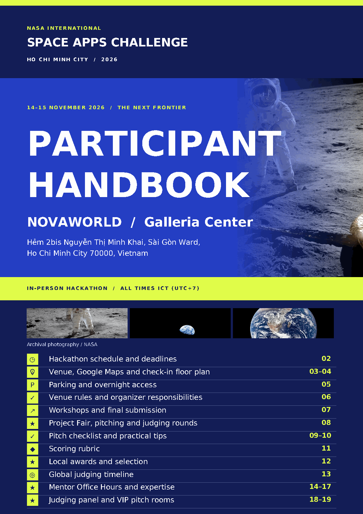

## Trang 2

### Văn bản trích xuất từ PDF

```text
NASA SPACE APPS CHALLENGE / HO CHI MINH CITY 2026 ◷
The two-day schedule.
In person at Galleria Center / Vietnam time (ICT, UTC+7)
SATURDAY / 14 NOVEMBER SUNDAY / 15 NOVEMBER
Check-in Day 2 check-in
08:00 08:00
Opening remarks Resume hacking
09:00 09:00
Start hacking Mentor Office Hours (pp. 14–17)
09:45 10:00
Lunch break Lunch break
12:00 12:00
Mentor Office Hours (pp. 14–17) Project Fair and judging pitches (see
14:30 14:00
p. 8)
Team progress check-in People’s Choice voting
16:30 16:00
Dinner break Local awards announcement*
18:00 16:30
Mentor Office Hours (pp. 14–17) Closing ceremony
19:00 17:00
Day 2 schedule briefing Online reminder to submit the final
21:00 23:00
project before 23:59
Head home or stay to hack with
21:30
overnight registration
*The detailed agenda lists People’s Choice voting at 16:00 and awards at 16:30. A separate organizer note
gives 16:00 for awards. The award time is pending confirmation.
Pitch preparation and final submission
Sat evening: practice with mentors and check Discord for the pitching order. Sun: have at
least 7 slides ready before your turn. Submit your NASA Space Apps project before 23:59 ICT.
02
HACKATHON SCHEDULE
```

### Ảnh trang gốc

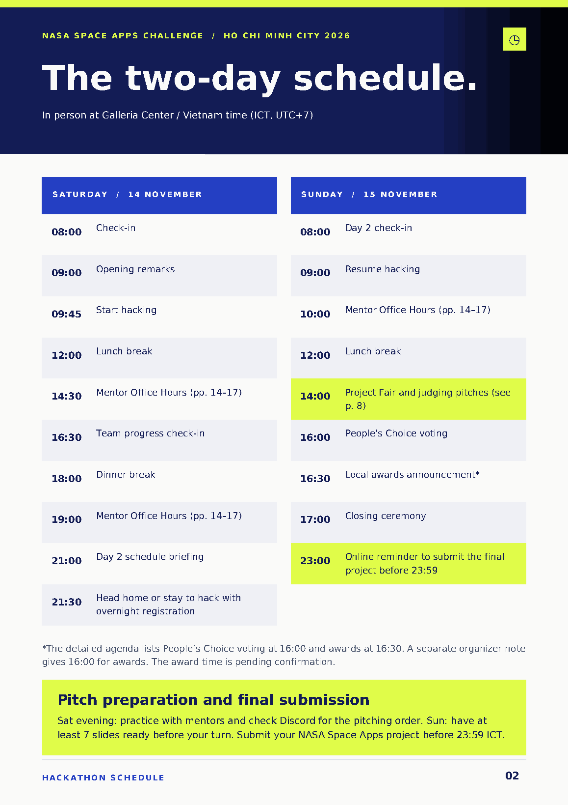

## Trang 3

### Văn bản trích xuất từ PDF

```text
NASA SPACE APPS CHALLENGE / HO CHI MINH CITY 2026
Find the venue.
Saturday 14 and Sunday 15 November 2026
NOVAWORLD
Galleria Center, Hẻm 2bis Nguyễn Thị Minh Khai, Sài Gòn Ward, Ho Chi Minh City 70000,
Vietnam.
VENUE PIN
QPQ3+XRM
Open Google Maps ↗
03
VENUE & GOOGLE MAPS
```

### Liên kết trong trang gốc

- <https://www.google.com/maps/search/?api=1&query=QPQ3%2BXRM%2C+Ho+Chi+Minh+City>
- <https://www.google.com/maps/search/?api=1&query=QPQ3%2BXRM%2C+Ho+Chi+Minh+City>

### Ảnh trang gốc

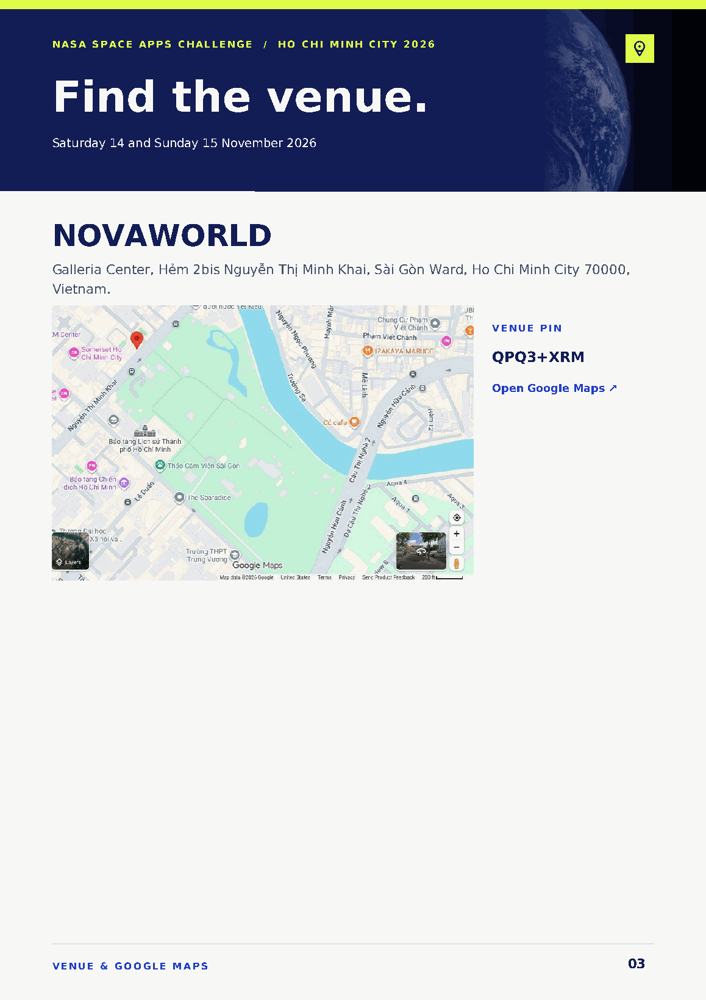

## Trang 4

### Văn bản trích xuất từ PDF

```text
NASA SPACE APPS CHALLENGE / HO CHI MINH CITY 2026
Find your check-in.
NOVAWORLD / Galleria Center
SIMPLIFIED GALLERY FLOOR PLAN
Rooms / stairs Storage VIP rooms Restrooms
Display area
MENTOR BOOTHS
Open area
Central floor
Café / seating
MENTOR BOOTHS
ENTRANCE
Shopfronts
Check-in
The blue rows show the mentor booths. Enter and check in below the Display Area.
Check the LED screen for mentor availability
During Mentor Office Hours, the venue LED screen shows each mentor’s current booth and
availability in real time. Check the screen before heading to a booth.
04
GALLERIA FLOOR PLAN
```

### Ảnh trang gốc

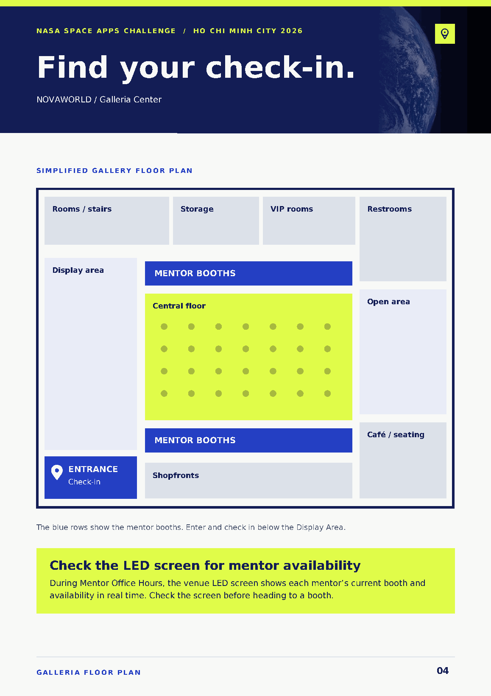

## Trang 5

### Văn bản trích xuất từ PDF

```text
NASA SPACE APPS CHALLENGE / HO CHI MINH CITY 2026 P
Parking and overnight.
Galleria Center / Saturday 14 to Sunday 15 November
Parking location and hours
Use the parking lot in front of Galleria Center at 2Bis Nguyễn Thị Minh Khai. The lot serves
the event from 06:00 Saturday, 14 November until 17:00 Sunday, 15 November.
VEHICLE DAYTIME OVERNIGHT
Motorcycle VND 10,000 VND 40,000
Car VND 50,000 VND 200,000
Fees are per parking session and payable directly at the lot. Park in the designated area,
keep your ticket, and follow parking staff instructions.
Leaving a vehicle overnight
Register with the Organizing Team before 17:00 on Saturday, 14 November. Provide your
license plate, vehicle type and contact phone number. The team forwards the list to the
parking operator. Requests outside the registered list are subject to space availability.
Staying at the Gallery overnight
Complete the Organizing Team’s overnight check-in form. Access after regular hours is
limited to registered attendees. Follow staff instructions and rest only in the designated
area.
Register a vehicle for overnight parking
Confirm whether you will stay overnight
05
PARKING & OVERNIGHT ACCESS
```

### Liên kết trong trang gốc

- <https://docs.google.com/forms/d/e/1FAIpQLSf5S-QzTkGq05WB9kfbK2ms1VoR4KCgzrqK75CRHT5bY4fwwg/viewform?usp=header>
- <https://docs.google.com/forms/d/e/1FAIpQLSfBFyhGGlu6M7KjbPm5Zg8cxwU_Gj31AkxqozpST3z52GT6uQ/viewform?usp=header>

### Ảnh trang gốc

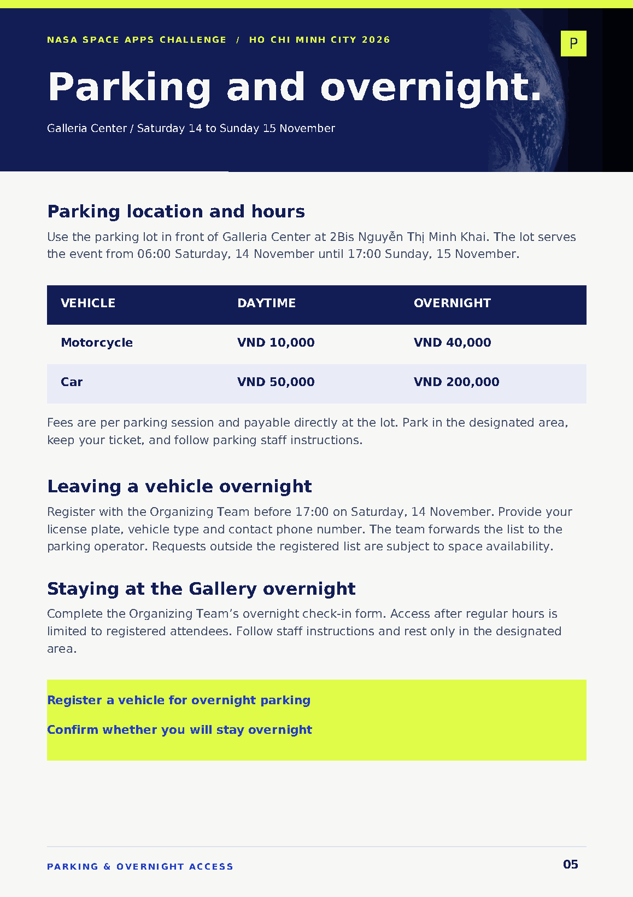

## Trang 6

### Văn bản trích xuất từ PDF

```text
NASA SPACE APPS CHALLENGE / HO CHI MINH CITY 2026 ✓
Using the Gallery.
Venue rules apply from 08:00 on 14 November to 18:00 on 15 November.
Food and drinks
Eat and drink in the designated area agreed with Gallery Management. Avoid
strong-smelling, crumbly or greasy food. Cooking is prohibited. Clear away food and drinks
after use.
Waste sorting
Use indoor bins for paper and ordinary dry waste. Use outdoor bins for food waste, cups,
bottles containing liquid, food packaging and other wet waste. Keep leftovers, liquids and
odorous waste out of indoor bins.
Restrooms
Use the designated restrooms and leave them clean. Keep rubbish, paper towels, personal
items and unsuitable waste out of toilets. Keep floors dry and fixtures in place. Report
clogs, leaks or damage to Gallery Management promptly.
Overnight conduct
Keep noise low and use the agreed rest area. Leave function rooms, technical areas and
venue equipment undisturbed. Smoking, open flames, cooking and flammable or explosive
items are prohibited. Follow staff instructions for lights, electrical devices and air
conditioning. Leave building electrical, technical and fire safety systems to authorized staff.
Organizer responsibilities and venue handover
Brief all staff, contractors and attendees. Assign staff to monitor cleanliness, security and
order. Keep waste in the designated collection area and clear it before overnight. Register
overnight attendees, staff the venue overnight and coordinate access and incident
response with Gallery Management.
At 18:00 on Sunday, 15 November, the Organizing Team is responsible for waste removal,
full cleaning, restoring equipment and returning the space in its original condition for
inspection and handover.
06
VENUE RULES
```

### Ảnh trang gốc

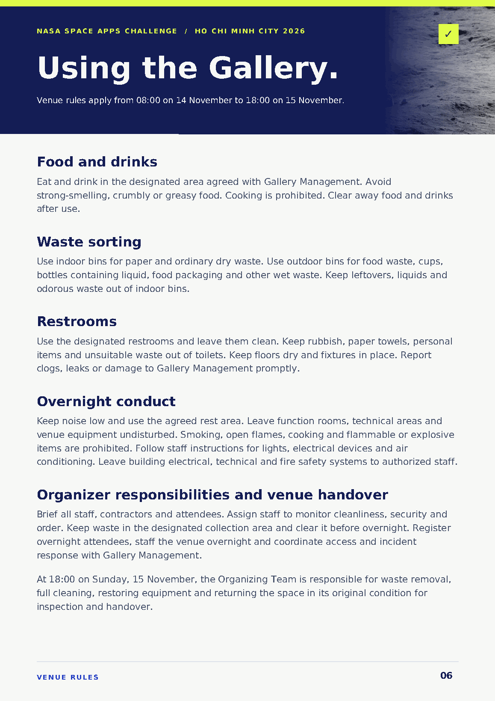

## Trang 7

### Văn bản trích xuất từ PDF

```text
NASA SPACE APPS CHALLENGE / HO CHI MINH CITY 2026 ↗
Prepare and submit.
Pre-event sessions, submission checklist and official resources
Thursday, 22 October / 19:00
2026 Challenges Briefing. Online workshop to explore the challenges and discuss them with
mentors.
Sunday, 1 November / 20:00–21:00
Presentation and 30-Second Video Workshop. Ms. Vinh Dao from the University of Transport
and Communications shared how to prepare a pitch and communicate an idea in 30
seconds. The online workshop was free.
Google Meet / Presentation and 30-Second Video Workshop
Monday, 9 November / 20:00
Pre-event Online Meet-up. An ask-me-anything session with mentors, organizers and
participants for team formation and final preparation.
Google Meet / Pre-event Online Meet-up
Final project submission / Before 23:59 ICT
On Sunday, 15 November, complete your project submission on the NASA Space Apps
platform. Describe your challenge, method and results. Credit the datasets and resources
you used, test shared links and follow the submission fields and instructions shown on the
platform. Check the official event Discord for local updates.
About NASA Space Apps
The 2026 theme is The Next Frontier. This global hackathon brings people together to
tackle challenges on Earth and in space using open data from NASA and its Space Agency
Partners.
2026 NASA Space Apps event hub
Official 2026 challenge catalog
2026 participant terms and conditions
07
WORKSHOPS & FINAL SUBMISSION
```

### Liên kết trong trang gốc

- <https://meet.google.com/meet/atz-aizq-bkz>
- <https://meet.google.com/njy-bnsa-vcn>
- <https://www.spaceappschallenge.org/2026/>
- <https://www.spaceappschallenge.org/2026/challenges/>
- <https://www.spaceappschallenge.org/legal/>

### Ảnh trang gốc

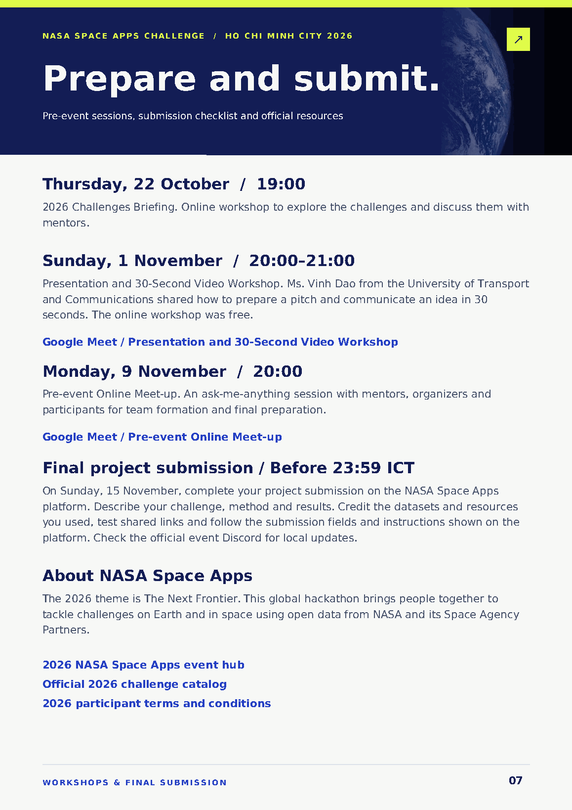

## Trang 8

### Văn bản trích xuất từ PDF

```text
NASA SPACE APPS CHALLENGE / HO CHI MINH CITY 2026 ★
Pitching and judging.
Ho Chi Minh City local judging and selection for Global Judging
Round 1 / In-person judging
This round is open to teams competing in person. Every in-person team must have a deck
of at least seven slides ready before its scheduled pitch. Judging begins at 14:00 on
Sunday, 15 November. All in-person teams pitch in their assigned VIP room. See pages
18–19 for the judging panel and room instructions.
Round 2 / Ho Chi Minh City regional selection
All in-person projects are scored again from scratch alongside projects from the online
track. This is an independent round with fresh scores. The top 10% of projects from the
combined Ho Chi Minh City pool will be nominated for Global Judging.
Project Fair / Sunday at 14:00
Teams showcase their work at their tables and demonstrate their projects to fellow
participants. Walk around to explore other projects, ask questions, exchange feedback,
learn from other approaches and connect with other teams.
SEVEN-SLIDE PITCH STRUCTURE / CHECKLIST ON PAGES 9–10
Name the project, team and selected challenge.
01 Project and team
Show who faces the problem and why it matters.
02 Problem and users
Explain what you built and how it addresses the challenge.
03 Proposed solution
Name the datasets and show how they drive the solution.
04 NASA data
Walk judges through the prototype or a typical use case.
05 Method and demo
Show tests, limitations and the expected benefits.
06 Validation and impact
Explain what you would improve, test or deploy next.
07 Next steps
08
JUDGING & PITCHING
```

### Ảnh trang gốc

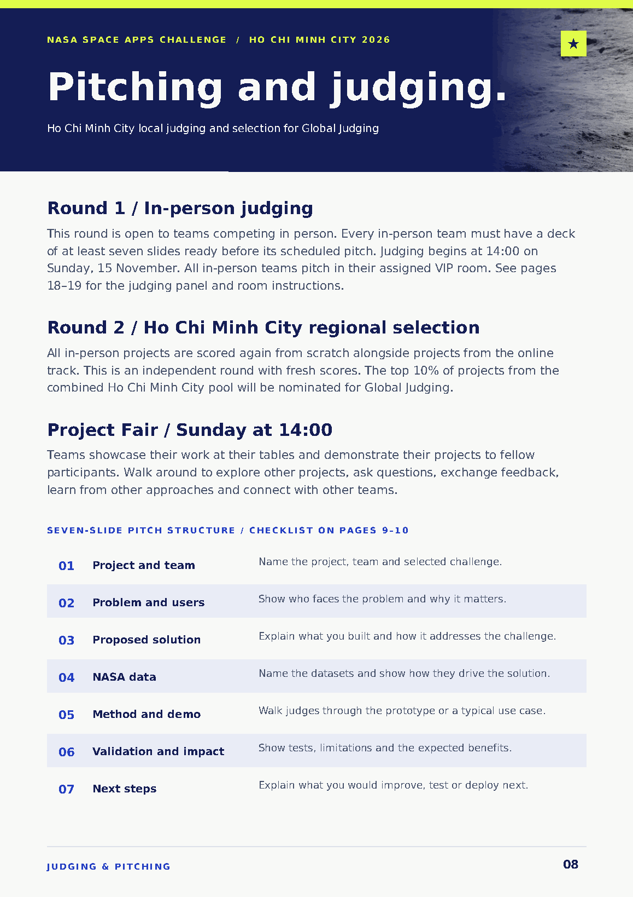

## Trang 9

### Văn bản trích xuất từ PDF

```text
NASA SPACE APPS CHALLENGE / HO CHI MINH CITY 2026 ★
Before you pitch.
Local presentation and NASA Space Apps platform submission
HCMC in-person pitch / Sunday, 15 November
Saturday evening, 14 November: Practice pitching with mentors and check the official
event Discord for the team pitching order and VIP room assignments. Sunday from 14:00
ICT: Pitch to the judges in your assigned VIP room. Have a deck of at least seven slides
ready before your turn.
NASA Space Apps 2026 / Platform submission
Register for the hackathon, select your Local Event and form or join a team. NASA Space
Apps says teams should have no more than six participants. Submit via the Project tab on
your team page. The platform opens at 09:00 on 14 November and closes at 23:59 on 15
November, local time. A project submission is required for Global Judging eligibility.
Demo format / Check the current guide
The seven-slide minimum is a HCMC live-pitch requirement. A previous NASA Space Apps
guide listed a public demo link with up to seven slides or a video up to 30 seconds. The
2026 format limits could not be verified when this handbook was prepared. Check the
current Project Submission Guide and the fields in your team’s Project tab before uploading.
Before you hit Submit
Check that the project title, chosen challenge, team roster and required fields are correct.
Explain what you built, where your data came from and how it was used. Test every shared
link in a signed-out window. Assign one teammate to submit early and verify the
submission state before the deadline.
NASA Space Apps / 2026 participant timeline
NASA Space Apps / Current resources and participant guides
NASA Space Apps / 2026 terms and conditions
09
PITCH & SUBMISSION CHECKLIST
```

### Liên kết trong trang gốc

- <https://www.spaceappschallenge.org/2026/>
- <https://www.spaceappschallenge.org/resources/>
- <https://www.spaceappschallenge.org/legal/>

### Ảnh trang gốc

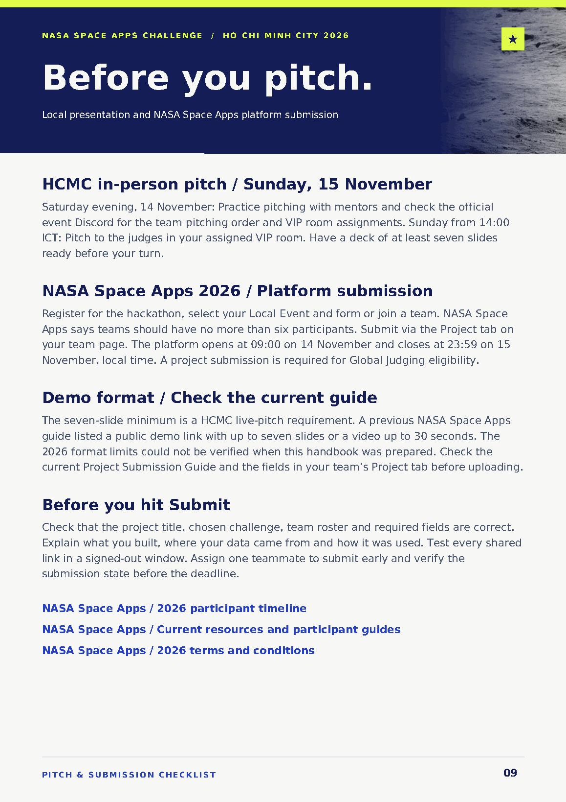

## Trang 10

### Văn bản trích xuất từ PDF

```text
NASA SPACE APPS CHALLENGE / HO CHI MINH CITY 2026 ★
Make the demo count.
Practical tips for the project deck, live pitch and online demo
01 Start with the user and the decision
In one sentence, say who faces the problem, what decision they need to make and what
your project helps them do. Name the challenge early.
02 Show how the data changes the result
Name the dataset and show the path from input to output. For a mapping project, show
the source layer, your processing step and the resulting decision or map. Note the date
range, resolution and key limits where relevant.
03 Demo one complete workflow
Walk through one realistic use case from input to result. Save an offline PDF and a
screenshot or short screen recording so the judges can see the result if the connection
fails.
04 Give judges something they can evaluate
Show one test, a comparison with a baseline or a worked example. Identify what you built
during the event, what the prototype can demonstrate and what still needs testing.
05 Rehearse the pitch and Q&A
Use the time slot announced by the organizers. Practice the handoff between speakers.
Prepare short answers on data choice, accuracy, usability and what would be needed to
deploy the project.
06 If you make a short video
Open with the problem, spend most of the clip on the workflow, and finish with the result.
Use readable captions and check that the public link opens on a device outside your
team. Follow the current platform limits.
10
PITCH & DEMO TIPS
```

### Ảnh trang gốc

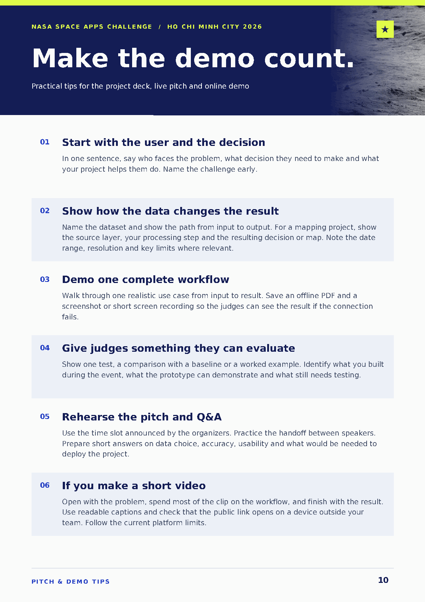

## Trang 11

### Văn bản trích xuất từ PDF

```text
NASA SPACE APPS CHALLENGE / HO CHI MINH CITY 2026 ◆
How projects are scored.
Five criteria, up to 5 points each / Final score out of 20
Judges score each criterion from 0 to 5. Add the five scores (maximum 25), then multiply by 0.8 for
the final score out of 20. For example, 20 out of 25 becomes 16 out of 20.
◎ Impact UP TO 5
How important is the problem, who benefits, and how much could their situation improve? Consider
the number of people or systems reached and the depth of the benefit.
Evidence to show. Define the intended users, describe the expected change, and name a measurable
outcome or realistic way to track it.
✦ Creativity UP TO 5
What is original in the concept, use of data, design or execution? An improvement to an existing idea
can score well if the difference is meaningful.
Evidence to show. Name the closest existing approach and show what you changed, how it works and
why it matters.
✓ Validity UP TO 5
Is the method scientifically sound, technically feasible and practical for its intended users? Consider
usability, accessibility, assumptions and limitations.
Evidence to show. Show a working demo, test or calculation. Explain what you validated and what still
needs to be tested.
Relevance
UP TO 5
Does the project directly address the chosen challenge and its objectives? Assess how NASA data
informs a core part of the solution.
Evidence to show. Name the challenge and datasets, then trace an input through the method to a
decision, feature or result.
▤ Presentation UP TO 5
Can the audience follow the challenge, proposed solution, method and significance? Consider
structure, delivery, demo clarity and how well the story supports the evidence.
Evidence to show. Make the problem and outcome clear early. Use legible visuals and connect the demo
back to the challenge.
Suggested score guide per criterion. 0 = no evidence · 1 = minimal · 2 = limited · 3 = adequate · 4 = well
supported · 5 = exceptionally well demonstrated.
11
SCORING RUBRIC
```

### Ảnh trang gốc

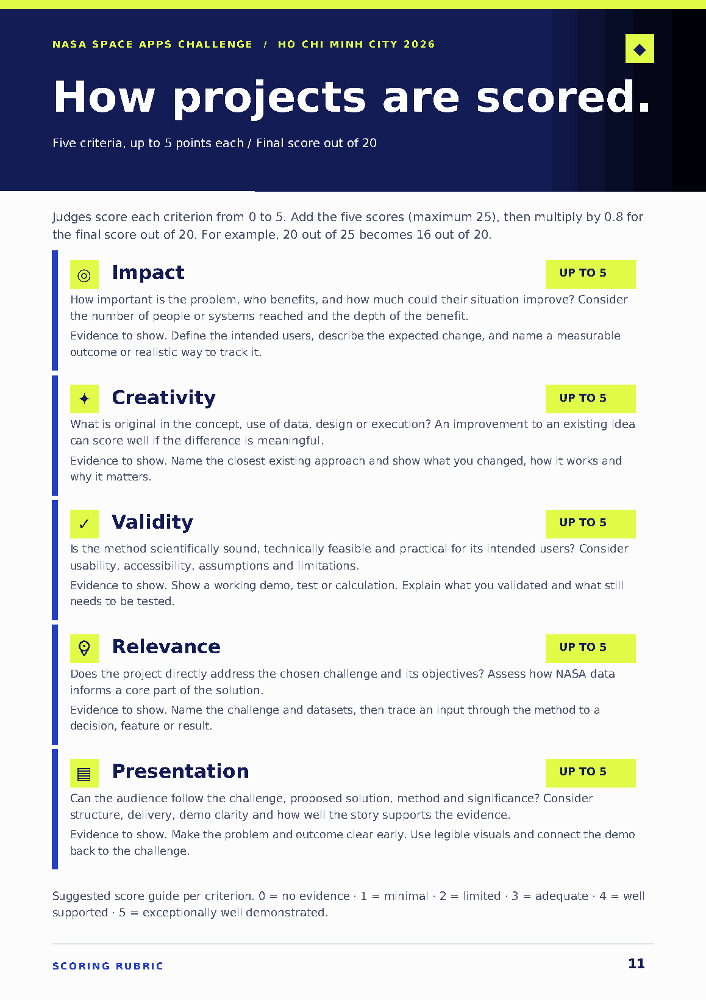

## Trang 12

### Văn bản trích xuất từ PDF

```text
NASA SPACE APPS CHALLENGE / HO CHI MINH CITY 2026 ★
Local hackathon awards.
Ho Chi Minh City in-person round / Eight awards
Second Place First Place Third Place
Judges rank the in-person teams by final rubric score out of 20. The top three teams receive First, Second
and Third Place.
People’s Choice Award
Attendees vote for their favorite project at 16:00 on Sunday, 15 November.
SPECIALTY AWARDS / SELECTED BY JUDGES
Award Award
Galactic Impact Best Mission Concept
Improves life on Earth or beyond. Presents a plausible mission with a practical
design.
Judging focus: Meaningful problem, clear
beneficiaries and measurable impact. Judging focus: Clear objectives, realistic
constraints and defensible design choices.
Award Award
Best Use of Storytelling Art & Technology
Shows what open data reveals through Combines artistic expression and technical
creative storytelling. execution.
Judging focus: Clear narrative, relevant evidence Judging focus: Clear artistic intent supported by
and an engaging format. the technology.
Local categories adapted from NASA Space Apps. Global nominations follow regional judging.
NASA Space Apps / Award descriptions
12
LOCAL AWARDS
```

### Liên kết trong trang gốc

- <https://www.spaceappschallenge.org/nasa-space-apps-2024/awards/>

### Ảnh trang gốc

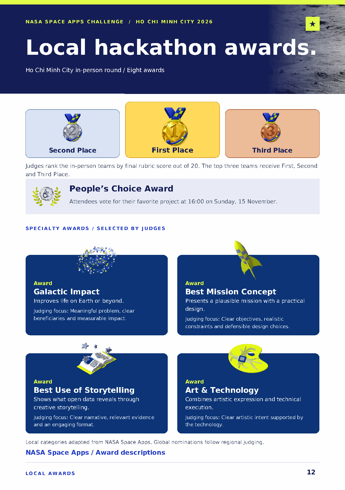

## Trang 13

### Văn bản trích xuất từ PDF

```text
NASA SPACE APPS CHALLENGE / HO CHI MINH CITY 2026 ◎
After the hackathon.
Global judging and announcement windows
Final project submission
15 NOV 2026
Submit through the NASA Space Apps platform before 23:59 Vietnam time.
Global judging and announcements
DEC 2026
Global review follows local nominations. Global Nominees, Global Finalists and
Honorable Mentions are expected to be announced in December.
Global Winners announced
JAN 2027
Global Winners are expected to be announced in January. Follow NASA Space
Apps for release dates and times.
NASA Space Apps / Official announcements
Planning windows based on the published 2026 event timeline shared by the Jaipur local organizer.
13
GLOBAL JUDGING TIMELINE
```

### Liên kết trong trang gốc

- <https://www.spaceappschallenge.org/>
- <https://www.wealthandelegance.in/nasa-space-apps-2026>

### Ảnh trang gốc

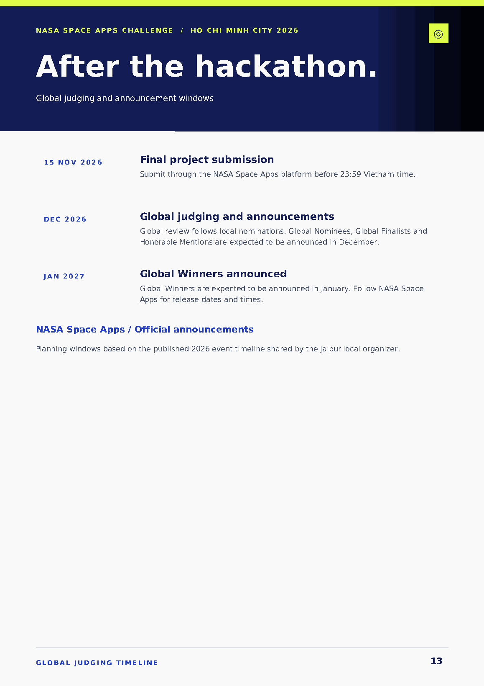

## Trang 14

### Văn bản trích xuất từ PDF

```text
NASA SPACE APPS CHALLENGE / HO CHI MINH CITY 2026 ★
Find the right mentor.
On-site hackathon mentors / Match your project to their expertise
Office Hours (ICT). Sat 14 Nov at 14:30 and 19:00 · Sun 15 Nov at 10:00.
Individual mentor slots are pending confirmation. See the booth map on page 17.
Use the project-fit column to find a mentor whose background matches what your team is building or
needs help with.
MENTOR / ROLE GOOD FIT FOR BACKGROUND & TOOLS
Dao Ngoc Vinh Pitch preparation, public Public speaking, writing and communications.
International Cooperation speaking and clear
Specialist / University of project writing
Transport Ho Chi Minh City
1 year · Vietnamese, English
Minh Phuong Astronaut training, Public speaking, writing, communications and
Deputy Director / Institute of mission games and space project management. Topics include NASA
equipment storytelling, astronaut training and
Low-Altitude Space storytelling
Development (ILASD), VASA mission-design games.
3 years · Vietnamese, English
Luong Cong Trung Astronaut health Public speaking, software development and
Nguyen software, prototypes and project management. Topics include NASA
equipment storytelling, astronaut training and
project planning
Head of Strategy & Operation /
astronaut health monitoring.
Olli, Inc.
6 years · Vietnamese
Pham Thu Trang (Chloe Visual design, pitch Graphic design, illustration, web and UI
Pham) storytelling and design, communications, public speaking and
project management. Topics include astronaut
astronaut-focused
CEO / Papers & Pens
training, health monitoring and mission-design
experiences
10 years · Vietnamese, English
games.
Phan Khanh Ha Web or mobile Web/mobile development, UX and project
Software Engineer / Papers & prototypes, UX and management. Tools: JavaScript, TypeScript,
HTML/CSS, VS Code and Claude. Topics:
Pens Digital interactive mission tools
astronaut training, health monitoring, NASA
4+ years · Vietnamese, English
storytelling, planetary analogs and mission
games.
14
MENTOR EXPERTISE
```

### Ảnh trang gốc

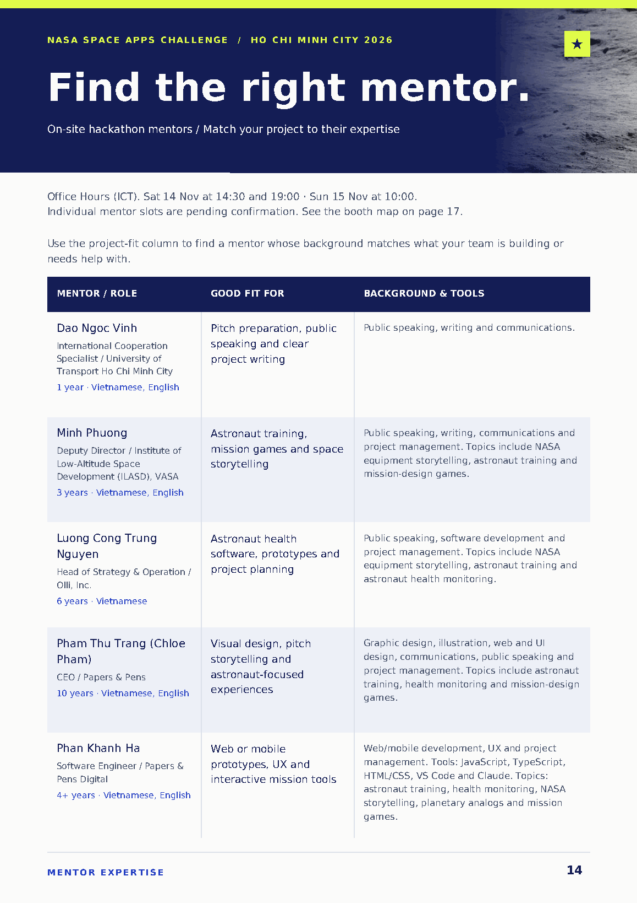

## Trang 15

### Văn bản trích xuất từ PDF

```text
NASA SPACE APPS CHALLENGE / HO CHI MINH CITY 2026 ★
Find the right mentor.
On-site hackathon mentors / Match your project to their expertise
Office Hours (ICT). Sat 14 Nov at 14:30 and 19:00 · Sun 15 Nov at 10:00.
Individual mentor slots are pending confirmation. See the booth map on page 17.
Use the project-fit column to find a mentor whose background matches what your team is building or
needs help with.
MENTOR / ROLE GOOD FIT FOR BACKGROUND & TOOLS
Pierre Rault UX/UI, interactive demos Public speaking, web design, UX/UI and project
CBO and Co-founder / Nopa and storytelling for space management. Topics include astronaut
training and health monitoring, SAR, Martian
Design projects
maps, Planet X and SPHEREx, NASA
12 years · English
equipment storytelling and mission-design
games.
Pham Thanh Thuy Earth observation, Data science, visualization and science
Doctor / VNUHCM University of geospatial visualization communication. Topics include Earth system
trends, SAR, agricultural adaptation,
Science and planetary mapping
MODIS/VIIRS hot spots, planetary analog sites
15 years · Vietnamese, English
and Martian mapping.
Pham Thi Mai Thy Satellite imagery, SAR Remote sensing and satellite data. Topics
Dr. / Vietnam National Space and remote-sensing include Earth system trends, SAR, agricultural
adaptation and harmonization of MODIS/VIIRS
Center (VNSC) workflows
hot spots.
25 years · Vietnamese, English
Tran Thi An Geospatial analytics, Data science, visualization, statistics,
Associate Professor / Thu Dau agriculture and satellite illustration, communications and project
management. Uses Python, Google Earth
Mot University hot-spot analysis
Engine, QGIS and ArcGIS. Topics include SAR,
More than 10 years ·
agricultural adaptation and MODIS/VIIRS hot
Vietnamese, English
spots.
15
MENTOR EXPERTISE
```

### Ảnh trang gốc

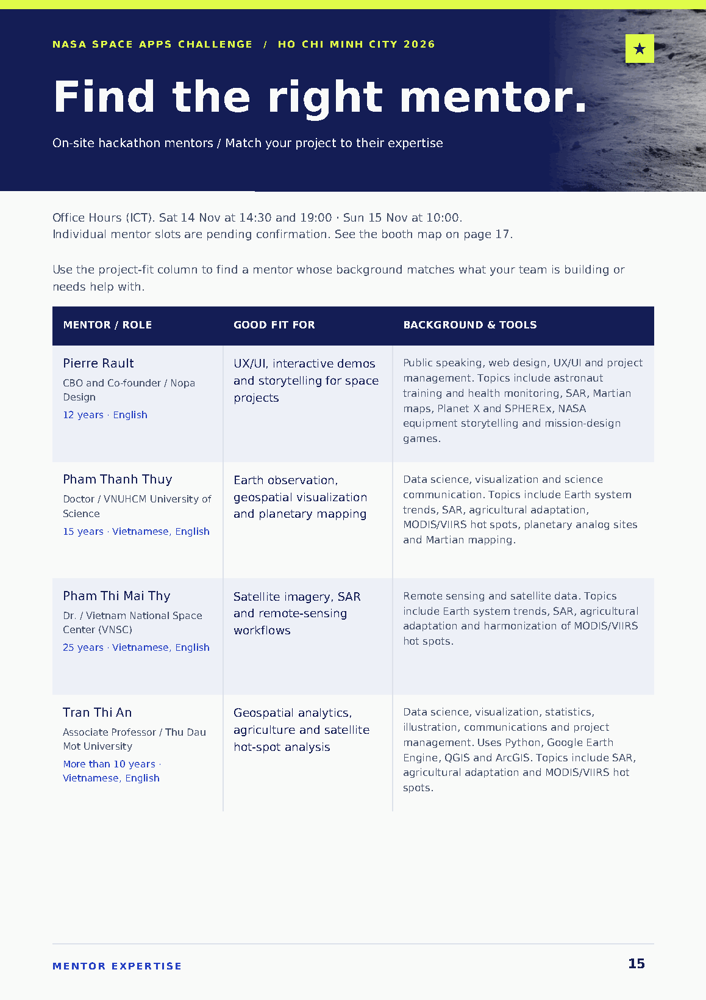

## Trang 16

### Văn bản trích xuất từ PDF

```text
NASA SPACE APPS CHALLENGE / HO CHI MINH CITY 2026 ★
Find the right mentor.
On-site hackathon mentors / Match your project to their expertise
Office Hours (ICT). Sat 14 Nov at 14:30 and 19:00 · Sun 15 Nov at 10:00.
Individual mentor slots are pending confirmation. See the booth map on page 17.
Use the project-fit column to find a mentor whose background matches what your team is building or
needs help with.
MENTOR / ROLE GOOD FIT FOR BACKGROUND & TOOLS
Do Thanh Long Community mapping, GIS decision-support tools for land use, natural
Researcher / Ho Chi Minh City WebGIS and near-Earth resources, agriculture and forestry. Develops
WebGIS and mobile apps using QGIS,
Space Technology Application object visualization
Center GeoServer and Python.
10+ years · Vietnamese
Do Minh Phung OpenStreetMap, Collects street-level imagery, digitizes
Map Product Operations / Be transport mapping and transport data in OpenStreetMap and
improves map-data workflows. Uses QGIS.
Group map-data workflows
Vietnamese, English
Nhat Nguyen Mission planning, Space Apps advisor with expertise in mission
Mission Manager / Space community mapping and and project management. Can advise on
community mapping and agricultural decisions
Machines Company Earth observation for
using Earth observation data.
English agriculture
Join Google Meet
Nguyen Luong Software and AI products, Develops strategy and software and AI
Strategy & Operations Lead / climate storytelling and products. Can advise on product
management, UI/UX, climate storytelling,
Buymed data visualization
SDGs and space science visualization.
5 years · English, Vietnamese
16
MENTOR EXPERTISE
```

### Liên kết trong trang gốc

- <https://meet.google.com/yfb-ircm-wcs>

### Ảnh trang gốc

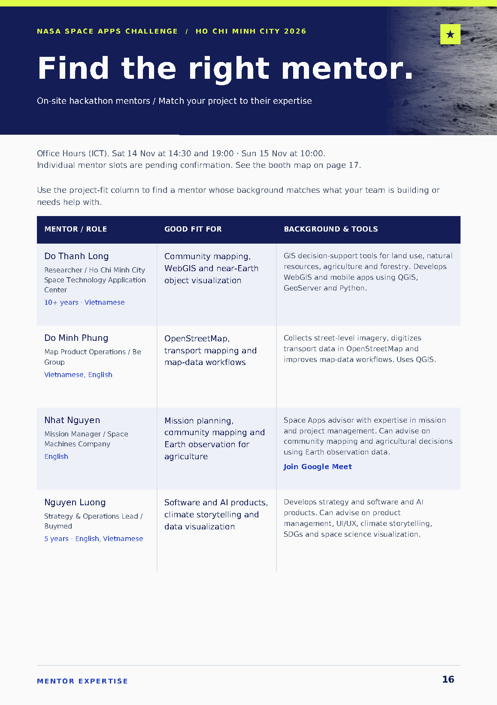

## Trang 17

### Văn bản trích xuất từ PDF

```text
NASA SPACE APPS CHALLENGE / HO CHI MINH CITY 2026 ★
Find your mentor booth.
Mentor Office Hours / Live booth assignments and availability
SIMPLIFIED GALLERY FLOOR PLAN
Rooms / stairs Storage VIP rooms Restrooms
Display area
MENTOR BOOTHS
Open area
Central floor
Café / seating
MENTOR BOOTHS
ENTRANCE
Shopfronts
Check-in
The blue rows show the mentor booths. Enter and check in below the Display Area.
Check the LED screen for mentor availability
During Mentor Office Hours, the venue LED screen shows each mentor’s current booth and
availability in real time. Check the screen before heading to a booth.
17
MENTOR BOOTH MAP
```

### Ảnh trang gốc

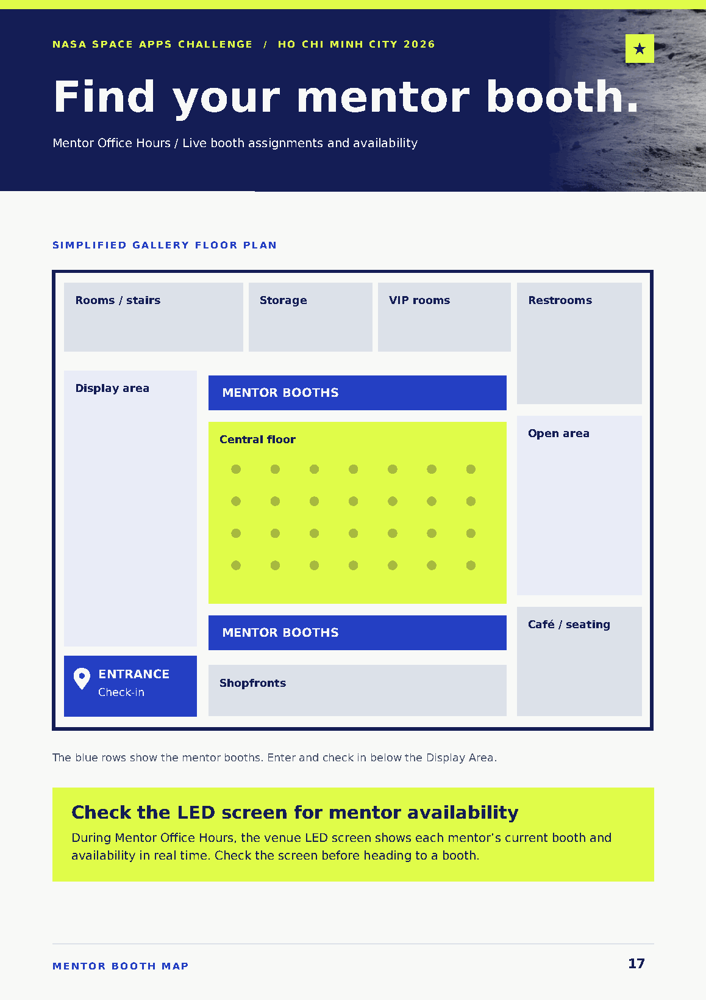

## Trang 18

### Văn bản trích xuất từ PDF

```text
NASA SPACE APPS CHALLENGE / HO CHI MINH CITY 2026 ★
Meet the judging panel.
In-person judging / Sunday, 15 November from 14:00
Eight judges will be assigned across three VIP rooms. Each in-person team pitches to the judges in its
assigned room. The organizing team will post the team pitching order and VIP room assignments on
the official event Discord on Saturday evening, 14 November. Please follow Discord for updates.
Nguyen Hoang Anh Lam Dao Nguyen
PhD in Ecological Modeling PhD in Remote Sensing
Faculty of Environment and Natural Vietnam National Space Center expert and
Resources, HCMUT, VNU-HCM. Studies spatial former director of its Ho Chi Minh City Space
data, environmental models, mangroves and Technology Application Center. Specializes in
sustainable agriculture. satellite image processing and applied remote
sensing.
Le Quang Hung Ho Thi Xuan Ngan
MSc in Mechatronics and Sensor Systems Co-Founder and CEO, Mekong Dynamics
Technical Director and AI Center Director at Regional Coordinator at Impact Hub Network.
HTI. Over 25 years in telecommunications, Over eight years in entrepreneurship support
with expertise in IoT, remote monitoring and across Vietnam and Southeast Asia, with a
unmanned systems. focus on Mekong Delta businesses.
18
JUDGING PANEL & VIP PITCH ROOMS
```

### Ảnh trang gốc

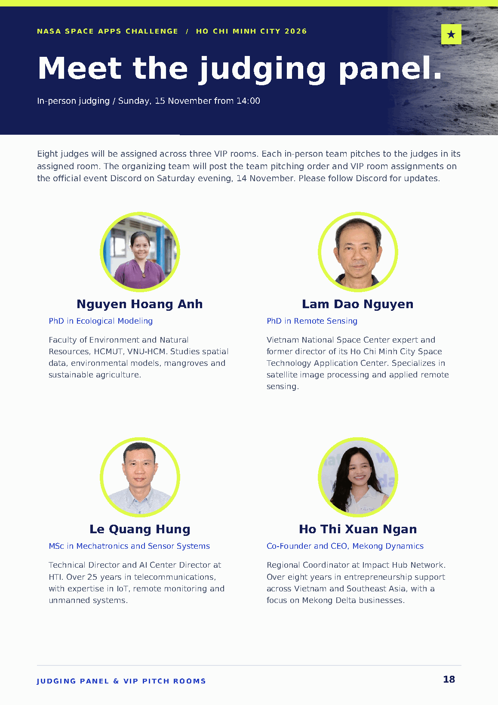

## Trang 19

### Văn bản trích xuất từ PDF

```text
NASA SPACE APPS CHALLENGE / HO CHI MINH CITY 2026 ★
Meet the judging panel.
In-person judging / Sunday, 15 November from 14:00
Check the official event Discord for the team pitching order and VIP room assignments. One judge
profile is pending.
Tran Thong Nhat Hoang Pham Gia Khang
PhD · Deputy Dean Bachelor’s in Computer Science
Ho Chi Minh City University of Natural Works across technology, art and design,
Resources and Environment. Researches GIS, using sensors, data and automation to build
remote sensing, UAVs and digital twins for interactive systems.
environmental modeling, agriculture and
smart cities.
David Lewis
Chairman and CEO, Energy Capital Vietnam
Senior advisor at SoiHUB/SAIGONTEL with
over ten years of experience in Vietnam
spanning infrastructure, energy, innovation
and investment.
19
JUDGING PANEL & VIP PITCH ROOMS
```

### Liên kết trong trang gốc

- <https://www.linkedin.com/posts/rmitvnscd_congratulations-to-our-winners-of-the-activity-7495706301914845184-eee8>

### Ảnh trang gốc

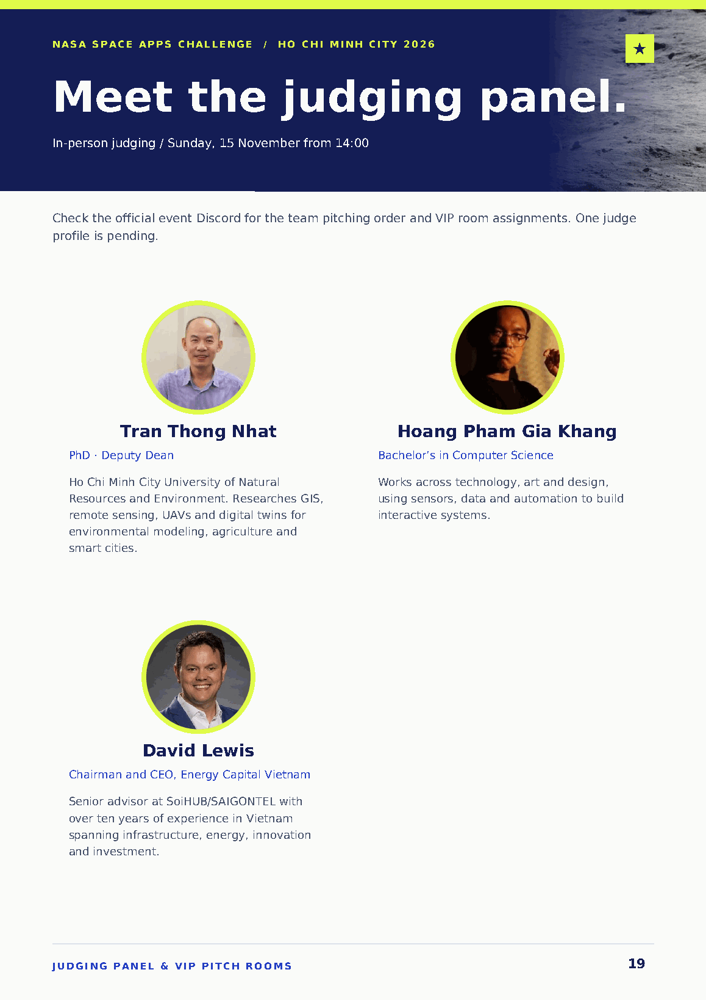
