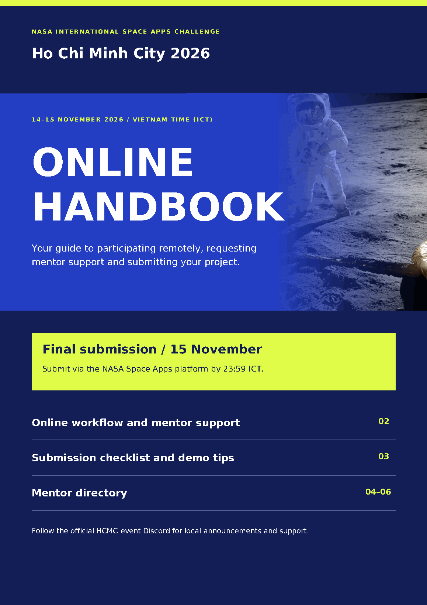
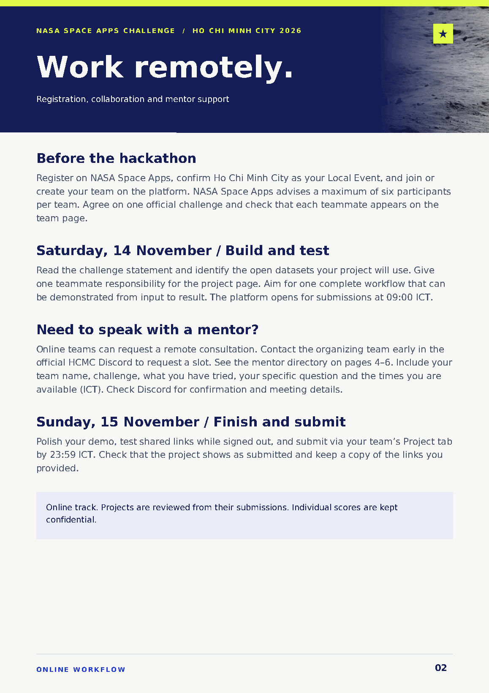
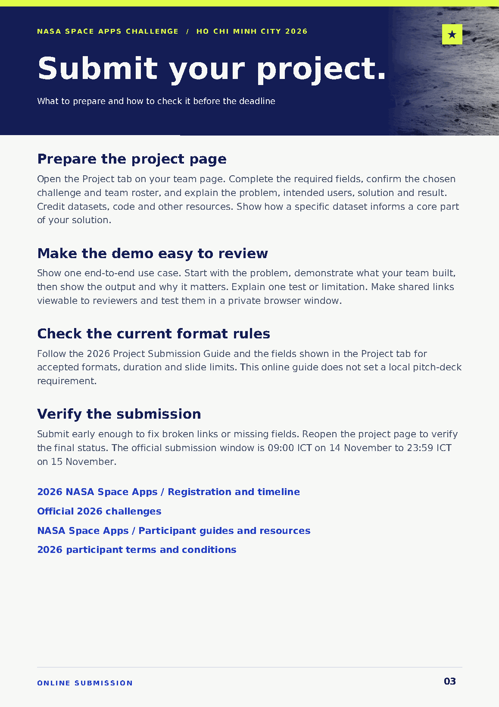
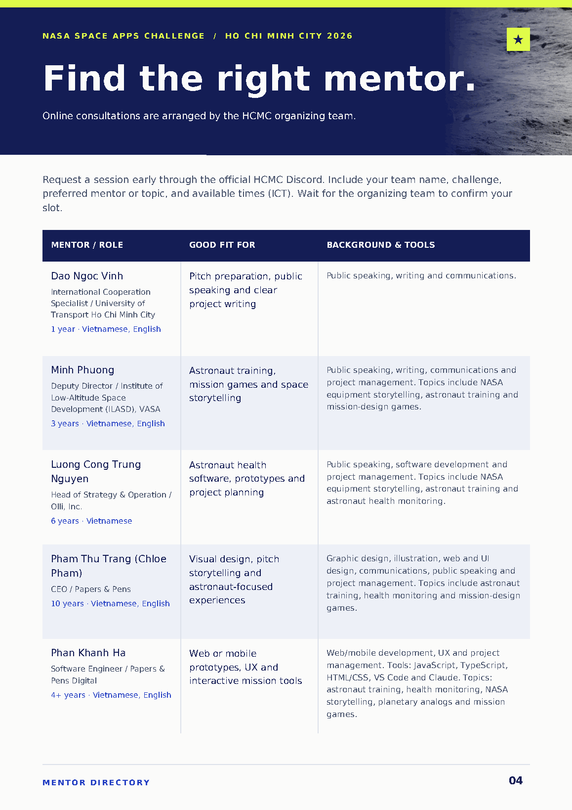
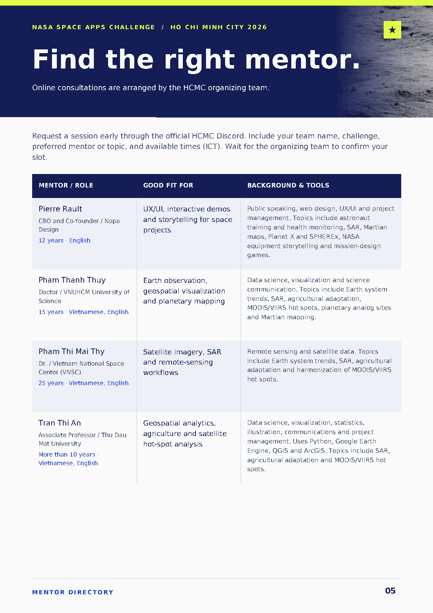
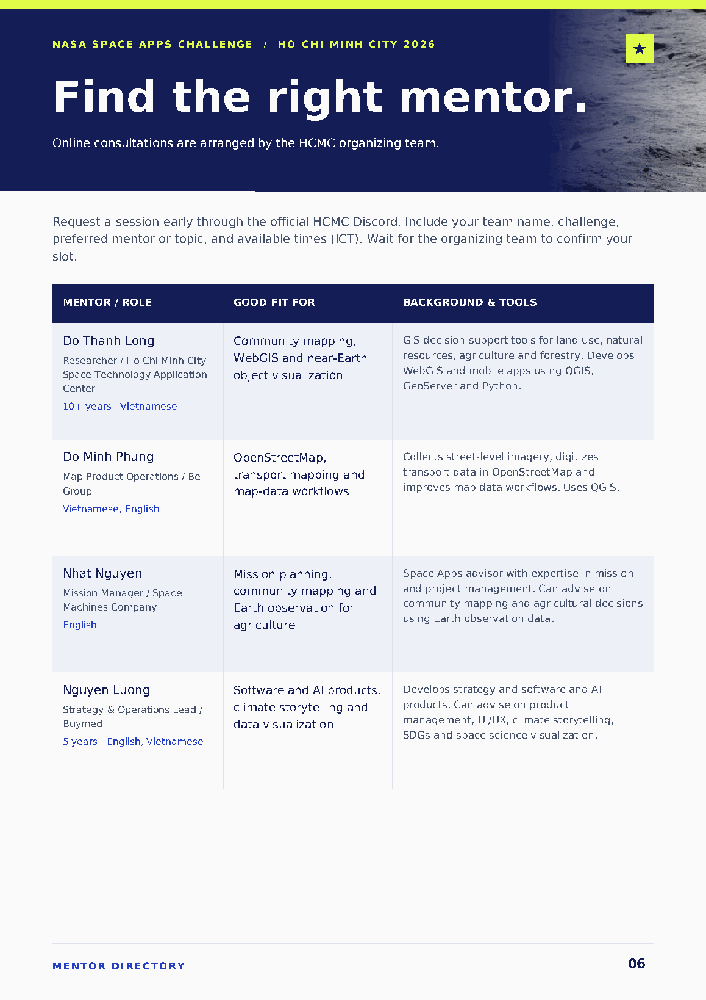

# Space_Apps_HCMC_2026_Online_Handbook

> Nội dung được chuyển từ PDF theo thứ tự trang, không tóm tắt. Ảnh từng trang giữ nguyên phần trình bày, hình ảnh, bảng biểu và chữ trong ảnh. Phần nhận dạng chữ từ ảnh (OCR) hỗ trợ tìm kiếm và có thể có sai sót; đối chiếu ảnh trang gốc khi cần.

## Trang 1

### Văn bản trích xuất từ PDF

```text
NASA INTERNATIONAL SPACE APPS CHALLENGE
Ho Chi Minh City 2026
14–15 NOVEMBER 2026 / VIETNAM TIME (ICT)
ONLINE
HANDBOOK
Your guide to participating remotely, requesting
mentor support and submitting your project.
Final submission / 15 November
Submit via the NASA Space Apps platform by 23:59 ICT.
Online workflow and mentor support 02
Submission checklist and demo tips 03
Mentor directory 04–06
Follow the official HCMC event Discord for local announcements and support.
```

### Ảnh trang gốc



## Trang 2

### Văn bản trích xuất từ PDF

```text
NASA SPACE APPS CHALLENGE / HO CHI MINH CITY 2026 ★
Work remotely.
Registration, collaboration and mentor support
Before the hackathon
Register on NASA Space Apps, confirm Ho Chi Minh City as your Local Event, and join or
create your team on the platform. NASA Space Apps advises a maximum of six participants
per team. Agree on one official challenge and check that each teammate appears on the
team page.
Saturday, 14 November / Build and test
Read the challenge statement and identify the open datasets your project will use. Give
one teammate responsibility for the project page. Aim for one complete workflow that can
be demonstrated from input to result. The platform opens for submissions at 09:00 ICT.
Need to speak with a mentor?
Online teams can request a remote consultation. Contact the organizing team early in the
official HCMC Discord to request a slot. See the mentor directory on pages 4–6. Include your
team name, challenge, what you have tried, your specific question and the times you are
available (ICT). Check Discord for confirmation and meeting details.
Sunday, 15 November / Finish and submit
Polish your demo, test shared links while signed out, and submit via your team’s Project tab
by 23:59 ICT. Check that the project shows as submitted and keep a copy of the links you
provided.
Online track. Projects are reviewed from their submissions. Individual scores are kept
confidential.
02
ONLINE WORKFLOW
```

### Ảnh trang gốc



## Trang 3

### Văn bản trích xuất từ PDF

```text
NASA SPACE APPS CHALLENGE / HO CHI MINH CITY 2026 ★
Submit your project.
What to prepare and how to check it before the deadline
Prepare the project page
Open the Project tab on your team page. Complete the required fields, confirm the chosen
challenge and team roster, and explain the problem, intended users, solution and result.
Credit datasets, code and other resources. Show how a specific dataset informs a core part
of your solution.
Make the demo easy to review
Show one end-to-end use case. Start with the problem, demonstrate what your team built,
then show the output and why it matters. Explain one test or limitation. Make shared links
viewable to reviewers and test them in a private browser window.
Check the current format rules
Follow the 2026 Project Submission Guide and the fields shown in the Project tab for
accepted formats, duration and slide limits. This online guide does not set a local pitch-deck
requirement.
Verify the submission
Submit early enough to fix broken links or missing fields. Reopen the project page to verify
the final status. The official submission window is 09:00 ICT on 14 November to 23:59 ICT
on 15 November.
2026 NASA Space Apps / Registration and timeline
Official 2026 challenges
NASA Space Apps / Participant guides and resources
2026 participant terms and conditions
03
ONLINE SUBMISSION
```

### Liên kết trong trang gốc

- <https://www.spaceappschallenge.org/2026/>
- <https://www.spaceappschallenge.org/2026/challenges/>
- <https://www.spaceappschallenge.org/resources/>
- <https://www.spaceappschallenge.org/legal/>

### Ảnh trang gốc



## Trang 4

### Văn bản trích xuất từ PDF

```text
NASA SPACE APPS CHALLENGE / HO CHI MINH CITY 2026 ★
Find the right mentor.
Online consultations are arranged by the HCMC organizing team.
Request a session early through the official HCMC Discord. Include your team name, challenge,
preferred mentor or topic, and available times (ICT). Wait for the organizing team to confirm your
slot.
MENTOR / ROLE GOOD FIT FOR BACKGROUND & TOOLS
Dao Ngoc Vinh Pitch preparation, public Public speaking, writing and communications.
International Cooperation speaking and clear
Specialist / University of project writing
Transport Ho Chi Minh City
1 year · Vietnamese, English
Minh Phuong Astronaut training, Public speaking, writing, communications and
Deputy Director / Institute of mission games and space project management. Topics include NASA
equipment storytelling, astronaut training and
Low-Altitude Space storytelling
Development (ILASD), VASA mission-design games.
3 years · Vietnamese, English
Luong Cong Trung Astronaut health Public speaking, software development and
Nguyen software, prototypes and project management. Topics include NASA
equipment storytelling, astronaut training and
project planning
Head of Strategy & Operation /
astronaut health monitoring.
Olli, Inc.
6 years · Vietnamese
Pham Thu Trang (Chloe Visual design, pitch Graphic design, illustration, web and UI
Pham) storytelling and design, communications, public speaking and
project management. Topics include astronaut
astronaut-focused
CEO / Papers & Pens
training, health monitoring and mission-design
experiences
10 years · Vietnamese, English
games.
Phan Khanh Ha Web or mobile Web/mobile development, UX and project
Software Engineer / Papers & prototypes, UX and management. Tools: JavaScript, TypeScript,
HTML/CSS, VS Code and Claude. Topics:
Pens Digital interactive mission tools
astronaut training, health monitoring, NASA
4+ years · Vietnamese, English
storytelling, planetary analogs and mission
games.
04
MENTOR DIRECTORY
```

### Ảnh trang gốc



## Trang 5

### Văn bản trích xuất từ PDF

```text
NASA SPACE APPS CHALLENGE / HO CHI MINH CITY 2026 ★
Find the right mentor.
Online consultations are arranged by the HCMC organizing team.
Request a session early through the official HCMC Discord. Include your team name, challenge,
preferred mentor or topic, and available times (ICT). Wait for the organizing team to confirm your
slot.
MENTOR / ROLE GOOD FIT FOR BACKGROUND & TOOLS
Pierre Rault UX/UI, interactive demos Public speaking, web design, UX/UI and project
CBO and Co-founder / Nopa and storytelling for space management. Topics include astronaut
training and health monitoring, SAR, Martian
Design projects
maps, Planet X and SPHEREx, NASA
12 years · English
equipment storytelling and mission-design
games.
Pham Thanh Thuy Earth observation, Data science, visualization and science
Doctor / VNUHCM University of geospatial visualization communication. Topics include Earth system
trends, SAR, agricultural adaptation,
Science and planetary mapping
MODIS/VIIRS hot spots, planetary analog sites
15 years · Vietnamese, English
and Martian mapping.
Pham Thi Mai Thy Satellite imagery, SAR Remote sensing and satellite data. Topics
Dr. / Vietnam National Space and remote-sensing include Earth system trends, SAR, agricultural
adaptation and harmonization of MODIS/VIIRS
Center (VNSC) workflows
hot spots.
25 years · Vietnamese, English
Tran Thi An Geospatial analytics, Data science, visualization, statistics,
Associate Professor / Thu Dau agriculture and satellite illustration, communications and project
management. Uses Python, Google Earth
Mot University hot-spot analysis
Engine, QGIS and ArcGIS. Topics include SAR,
More than 10 years ·
agricultural adaptation and MODIS/VIIRS hot
Vietnamese, English
spots.
05
MENTOR DIRECTORY
```

### Ảnh trang gốc



## Trang 6

### Văn bản trích xuất từ PDF

```text
NASA SPACE APPS CHALLENGE / HO CHI MINH CITY 2026 ★
Find the right mentor.
Online consultations are arranged by the HCMC organizing team.
Request a session early through the official HCMC Discord. Include your team name, challenge,
preferred mentor or topic, and available times (ICT). Wait for the organizing team to confirm your
slot.
MENTOR / ROLE GOOD FIT FOR BACKGROUND & TOOLS
Do Thanh Long Community mapping, GIS decision-support tools for land use, natural
Researcher / Ho Chi Minh City WebGIS and near-Earth resources, agriculture and forestry. Develops
WebGIS and mobile apps using QGIS,
Space Technology Application object visualization
Center GeoServer and Python.
10+ years · Vietnamese
Do Minh Phung OpenStreetMap, Collects street-level imagery, digitizes
Map Product Operations / Be transport mapping and transport data in OpenStreetMap and
improves map-data workflows. Uses QGIS.
Group map-data workflows
Vietnamese, English
Nhat Nguyen Mission planning, Space Apps advisor with expertise in mission
Mission Manager / Space community mapping and and project management. Can advise on
community mapping and agricultural decisions
Machines Company Earth observation for
using Earth observation data.
English agriculture
Nguyen Luong Software and AI products, Develops strategy and software and AI
Strategy & Operations Lead / climate storytelling and products. Can advise on product
management, UI/UX, climate storytelling,
Buymed data visualization
SDGs and space science visualization.
5 years · English, Vietnamese
06
MENTOR DIRECTORY
```

### Ảnh trang gốc


